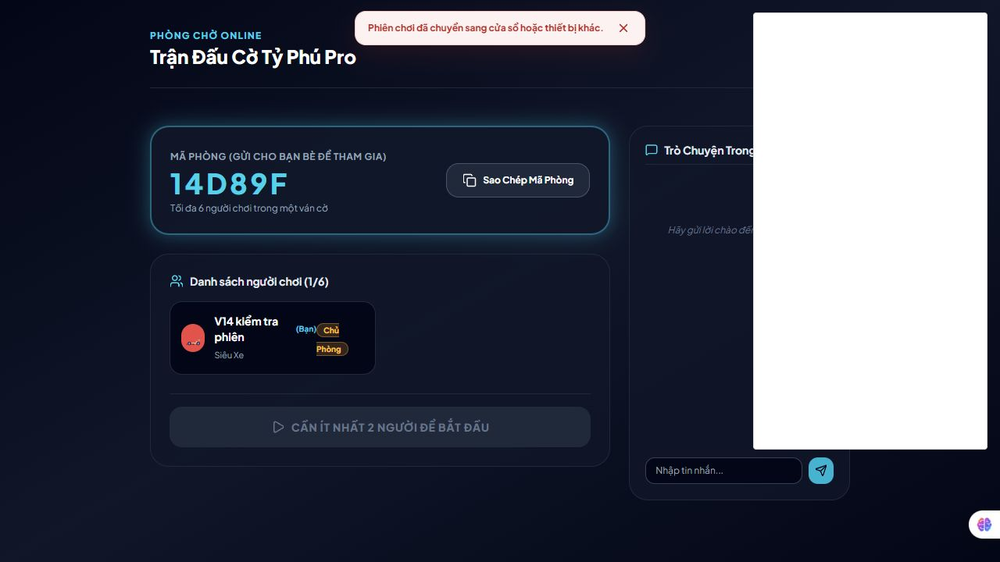

# Review V14 — đã review, sửa code và kiểm thử

Ngày **08/11/2026**, hoàn tất kiểm tra khoảng **09:40 giờ Việt Nam**. Làm trên workspace hiện tại, giữ các thay đổi có sẵn của bạn. Đợt này có sửa mã game/backend; **chưa commit, push hoặc deploy production**.

## Kết quả

**Đã thay đường Redis chưa hoàn chỉnh bằng Redis thật, sửa commit toàn phòng và khôi phục phiên, đồng thời kiểm thử hai backend độc lập.** Các ca phiên cũ ready/start và chat trùng mà bản bạn vừa sửa đã xử lý được tiếp tục qua test.

| Kiểm tra | Kết quả |
| --- | --- |
| `npm test` | **94/94 qua**: 23 bài nền + 71 bài Node runner |
| `npm run test:redis` với Redis thử nghiệm thật | **2/2 qua**, không skip |
| Tổng | **96 bài qua**, 0 lỗi |
| Build production | Thành công; main `index-D_uAc47K.js` |
| `git diff --check` | Qua |
| Oxlint phần liên quan | 0 lỗi; còn warning React/hooks cũ trong App/controller |
| Giao diện trình duyệt | Reload phòng chờ giữ chỗ; takeover hiện thông báo và khóa thao tác |

Redis kiểm thử là **Redis 7.4 trong container riêng trên máy**, không phải Map hoặc adapter file giả lập. Không dùng database production hoặc dữ liệu phòng thật của người chơi.

## 1. Redis trước sửa mới chỉ kiểm kết nối TCP — đã thay bằng implementation thật

Đọc source bản vừa nhận thấy `RedisStorageAdapter.get/set/has/delete` chỉ gọi `_verify()`, chưa gửi lệnh Redis. Việc endpoint sai gây lỗi không chứng minh endpoint đúng có thể lưu/đọc dữ liệu. `PersistentStorageAdapter` trong test vẫn là fixture file trên cùng máy.

**Đã thực hiện:**

- Thêm `server/redisRoomStore.js`, sử dụng thư viện `redis` đã cập nhật trong package/lockfile.
- Kết nối Redis TCP/TLS qua `REDIS_URL`; dùng command thật để đọc, commit và publish/subscribe.
- CAS bằng một Lua script tại Redis, so **version toàn room**, bao gồm cả metadata. State và kết quả request nằm trong cùng bản ghi commit.
- Chuyển handler Socket.IO sang async/await có bắt lỗi; không dùng cách gọi đồng bộ với client Redis bất đồng bộ.
- Cấu hình Redis thiếu trên Vercel trả health **503 JSON**, từ chối phiên online thay vì báo sẵn sàng trong khi chỉ lưu local.
- Snapshot gửi client chỉ gồm thông tin công khai của phòng, không gửi resume tokens hoặc active session map.

`ExternalRoomStore` có endpoint Redis sẽ dùng implementation thật. Các adapter Map/file được inject trong test cũ vẫn chỉ là fixture local và đã được ghi rõ trong hướng dẫn.

## 2. Merge gameState chưa bảo vệ metadata — đã sửa bằng commit theo version toàn phòng

Bản bạn vừa sửa có giữ gameState mới hơn khi `set()` nhận snapshot cũ. Cách đó vẫn có thể làm mất dữ liệu cùng game revision: người vừa join, resume token, pending offer hoặc session ownership của thao tác khác.

**Đã thực hiện:**

- `set()` local từ chối snapshot cũ theo room version; không trộn âm thầm dữ liệu cũ với state mới.
- `atomicUpdate()` kiểm cả version toàn room tại commit; clone sâu trước mutation để lỗi/conflict không làm bẩn cache.
- Join, resume, ready, start, leave, forfeit và trade dùng cùng đường cập nhật. Metadata bị conflict được đọc lại và thử trên snapshot mới; game action không tự reroll khi conflict.
- Result của `requestId` được lưu cùng game action. Retry trả kết quả đã commit và gửi lại snapshot để client khôi phục nếu bỏ lỡ broadcast.
- File store local ghi qua file tạm rồi rename; lỗi ghi không còn bị bỏ qua và trả thành công. Event file local cũng được ghi hoàn chỉnh trước khi watcher đọc.

Test bổ sung giữ nguyên game revision nhưng cập nhật hai loại metadata cạnh tranh: snapshot cũ bị từ chối; thao tác retry bảo toàn cả resume token và session mới.

## 3. Phiên bị thay thế: server đã cải thiện, client còn lỗi — đã sửa cả luồng

Các guard ready/start và dedupe của bản bạn gửi đã qua bài test V13. Phần client mới gọi `setBanner()` nhưng không khai báo hàm này, nên sự kiện `session_superseded` có thể phát sinh lỗi JavaScript.

**Đã thực hiện:**

- Dùng thông báo lỗi hiện có, khóa phiên và xóa token khôi phục của tab cũ để nó không tự giành lại phiên.
- Hủy animation, proposal đang mở và vô hiệu hóa callback cũ đang chờ ACK.
- Bỏ qua các snapshot/start đến muộn trên tab đã mất quyền; chúng không được tự bật lại thao tác.
- Khóa ready/start và ô gửi chat ở phòng chờ khi phiên không còn hoạt động; vẫn cho người dùng rời phòng.
- Không reset ván hoặc chạy lại animation cho snapshot cùng revision đã xử lý.
- Kiểm session ownership trong mutation tại server, gồm các thao tác điều khiển phòng và giao dịch.

**Đã kiểm bằng trình duyệt:** tạo phòng, tải lại trang vẫn ở phòng chờ; một kết nối khác nhận quyền cùng người chơi thì tab cũ hiện thông báo và nút chat bị disabled.



Ảnh kiểm thử có panel tiện ích trình duyệt che một phần vùng chat bên phải; thông báo và trạng thái khóa nút đã được xác nhận bằng cây giao diện.

## 4. Reload phòng chờ và timer sau restart — đã sửa

Khi thử UI, disconnect ở phòng chờ vẫn xóa người ngay, nên reload có thể mất chỗ/token dù app có luồng resume.

- Disconnect ở phòng chờ cũng giữ chỗ trong thời gian nối lại; guest mất kết nối được bỏ trạng thái ready.
- Start bị chặn nếu còn người đang mất kết nối.
- Deadline phiên được lưu trong store; heartbeat gia hạn khi kết nối còn sống.
- Timer kiểm session hiện tại và room mới nhất trước khi loại người. Callback của phiên cũ không loại phiên vừa resume.
- Nếu process chết và timer không chạy được, lần truy cập phòng kế tiếp xử lý deadline đã hết từ dữ liệu chung.
- Rời phòng rõ ràng vẫn rời ngay. Grace nối lại hiện là 60 giây; dữ liệu room Redis có TTL 24 giờ và được gia hạn khi cập nhật.

Có test cho reload/resume trước hạn và deadline đã hết nhưng không phụ thuộc timer của process cũ.

## 5. Entry và health cho Vercel

Bản bạn gửi đã đổi default export thành HTTP server thật, bỏ Proxy; giữ thay đổi này.

- Chuẩn hóa cả `/socket.io` và `/api/realtime/socket.io` ngay tại HTTP server, trước xử lý upgrade/request.
- Client dùng WebSocket transport.
- API health dùng trạng thái backend thật, cùng protocol `actions-v1`; không trả `{status:ok}` cố định khi datastore chưa kết nối.
- Cập nhật `.env.example`, `DEPLOY_ONLINE.md` và phần deploy trong README theo hướng **Vercel + Redis**, không bắt buộc tách backend sang Render.

Vercel có hỗ trợ WebSocket và yêu cầu kho ngoài cho rooms/state/presence/pub-sub giữa instance. [Tài liệu chính thức](https://vercel.com/docs/functions/websockets).

## 6. Đã thử những gì trên Redis thật?

`test/redisIntegration.test.js` chạy hai backend Node có thư mục temp riêng, cùng Redis thử nghiệm:

1. Host ở A tạo phòng, guest ở B vào và ready; guest nhận start đúng một lần.
2. Chat từ A sang B nhận đúng một lần.
3. Offer từ A, accept tại B; đọc mới từ Redis đúng tiền 14 triệu / 16 triệu.
4. Dùng fixture server-side xác định lần ghé ô 3, rồi mua/xây qua Socket.IO thật; đúng owner và cấp nhà. Fixture chỉ chuẩn bị lần ghé, không khẳng định đã kiểm mọi kết quả xúc xắc ngẫu nhiên qua mạng.
5. Retry cùng request không xây thêm; kết quả vẫn khôi phục được sau khi backend A dừng và backend C mới khởi động.
6. Resume đúng logical player, tiền, vị trí và tài sản. Phiên thay thế chặn phiên cũ; old leave không xóa người ở phiên mới.
7. Hai worker Redis độc lập cùng đọc revision 0 rồi cùng được thả commit: **một success, một conflict**, dữ liệu cuối chỉ có mutation thắng.

Test cũ được cập nhật để chờ kết quả async thật, kiểm request theo phòng, chấp nhận stale snapshot bị conflict rồi retry, và chờ sự kiện mạng thay vì chỉ ngủ một khoảng cố định.

## 7. Link public chưa có bản sửa này

Đọc lại [link đang dùng](https://monopoly-silk-ten.vercel.app) lúc **09:39 ngày 08/11/2026**:

| Kiểm tra | Kết quả |
| --- | --- |
| Trang chủ | HTTP 200, main `/assets/index-BarhytB4.js` |
| `/api/health` | HTML trang chủ, chưa phải health JSON |
| WebSocket `/socket.io` | Thất bại |
| Build local V14 | `/assets/index-D_uAc47K.js`, khác public |

**Chưa tuyên bố người ở nơi khác đã chơi được qua link public.** Source đã có đường Redis thật và đã kiểm ở local; production còn cần cấu hình/deploy/nghiệm thu riêng.

Việc cần làm trên Vercel:

1. Cấp Redis TCP/TLS URL có hỗ trợ Lua và pub/sub, đặt biến backend `REDIS_URL`.
2. Dùng `REDIS_KEY_PREFIX` riêng cho môi trường; giữ `VITE_SOCKET_URL` trống khi cùng domain và `VITE_SOCKET_PATH=/socket.io`.
3. Deploy đúng source/lockfile mới. Health phải là JSON có `status=ok`, `protocol=actions-v1`, `backend=redis`.
4. Kiểm cold deployment và hai thiết bị/hai mạng, gồm start, mua/xây, trade, reload/resume.

Không có Redis production URL hoặc liên kết deploy được cung cấp trong phiên này; không tạo tài khoản/khóa hay thay cấu hình cloud thay bạn. Hướng dẫn cụ thể nằm trong `DEPLOY_ONLINE.md`. REST URL không thay thế Redis TCP URL; không đưa mật khẩu Redis vào biến `VITE_`.

## 8. Giao diện bàn và luật Business Tour

- Engine mua/xây, bố trí ô và mô hình bàn 3D được giữ nguyên trong lượt sửa này; các test luật liên quan tiếp tục qua.
- Thay đổi UI tập trung vào trạng thái kết nối, khóa phiên, thông báo và xử lý snapshot/animation trùng.
- Chưa có lượt thiết kế lại mô hình nhà/quân cờ hay nâng mức đồ họa bàn cho giống ảnh Business Tour hơn. Chưa gọi ruleset 40 ô hiện tại là bản Business Tour đầy đủ.
- Backlog hình ảnh còn: chữ/giá rõ theo camera mặc định, mô hình nhà có silhouette dễ phân biệt, footprint không che số, quân cờ/animation có nhịp; World Tour nếu tiếp tục mục tiêu tính năng đó.
- Build còn cảnh báo Board3D 564,55 kB trước gzip; lint còn các warning React về render/effect/dependency cũ. Chưa coi đó là lỗi đã xử lý ở lượt backend này.

## File và bằng chứng

Các file chính: `server/redisRoomStore.js`, `server/roomCodec.js`, `server/roomStore.js`, `server/index.js`, API health/entry, controller, OnlineRoom, package/lockfile và hướng dẫn deploy.

Trong `docs/review-v14-2026-11-08/` có:

- `validation.json`: tổng 96 bài qua, thông tin build và phạm vi UI.
- `unit-output.txt`, `redis-output.txt`: log kiểm thử.
- `public-results.json`: probe public chỉ đọc; không tạo phòng public.
- `session-superseded.jpg`: ảnh xác nhận UI.
- `source-hashes.json`: snapshot source cuối để đối chiếu lượt sau.
- `collect-evidence.mjs`: kiểm tra log đã qua và tổng hợp bằng chứng.

Chạy lại:

```powershell
rtk npm test
rtk npm run build
$env:REDIS_TEST_URL='redis://127.0.0.1:16389'
rtk npm run test:redis
```

Lệnh Redis cần database thử nghiệm của bạn đang chạy; container dùng trong lượt kiểm tra này được dọn sau khi hoàn tất. Suite chỉ tạo/xóa key dưới prefix ngẫu nhiên của chính nó. Không có `REDIS_TEST_URL` thì test tích hợp skip, không phải đã kiểm Redis thành công.
