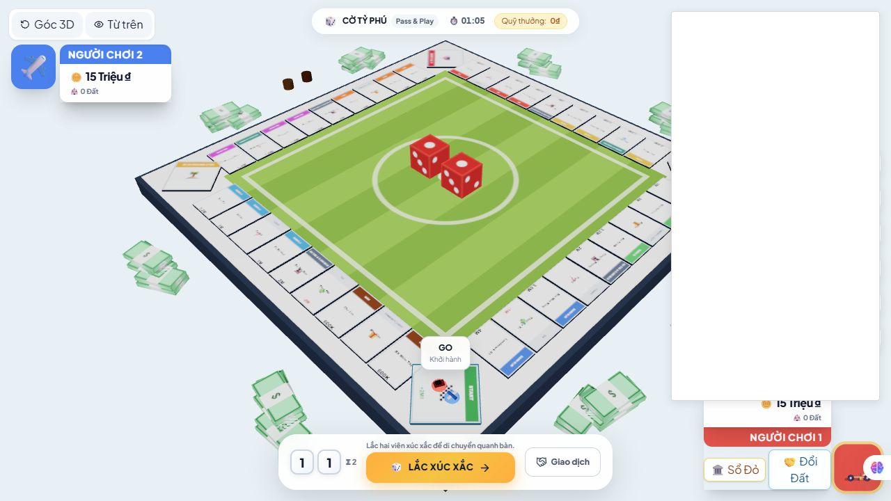

# Review V15 — Logic, online, giao diện và hướng nâng cấp cho Anti

Ngày: 08/11/2026. Mã nguồn: `b5da067` trên `main`.

**Yêu cầu lượt này: chỉ review và bàn giao, không sửa code game, không commit/push/deploy.** Các tệp mới trong lượt này là báo cáo, ảnh và chương trình chẩn đoán.

## 1. Kết luận để quyết định việc tiếp theo

- **Logic cốt lõi đã có nền tảng tốt**, dùng chung reducer cho người chơi online, local và bot. Chưa thể kết luận hết lỗi chỉ vì test xanh: lượt này tìm và tái hiện thêm **3 lỗi online** ngoài bộ test hiện có.
- **Online production hiện hoạt động:** `/api/health` trả `status: ok`, `backend: redis`, `protocol: actions-v1`. Không còn đúng nếu nói bản hiện tại chỉ chạy được cùng máy hoặc chưa có kho phòng chung.
- **Giao diện đã có bố cục gợi nhớ ảnh Business Tour**, nhưng độ rõ của tên ô/giá và chất lượng hình ảnh chưa đạt mong muốn của chủ dự án. Không nên đánh dấu hoàn thành chỉ vì đã có bàn nghiêng, nền xanh, xúc xắc đỏ và thẻ ở góc.
- **Mua nhà đã có chuỗi quyết định hợp lý:** chọn cấp 1–3 khi mua, xem trước, một lần xây mỗi lần ghé, Landmark cấp 4 cần Biệt thự từ lần ghé trước. Nên hoàn thiện trải nghiệm và kiểm chứng trên bàn thay vì viết lại cơ chế này.
- Vẫn là **game arcade 40 ô lấy cảm hứng từ Monopoly và Business Tour**. Chưa có cơ sở gọi là bản sao đầy đủ luật, tính năng hoặc chất lượng đồ họa Business Tour trên Steam.

Đối chiếu SHA-256 **34 tệp trong snapshot V14: không có thay đổi**. Đây là vòng kiểm tra sâu hơn trên cùng nền mã, không phải xác nhận một đợt sửa mới giữa V14 và V15. Xem `docs/review-v15-2026-11-08/source-comparison.json`.

## 2. Đã kiểm tra gì, giới hạn ở đâu

| Kiểm tra | Kết quả và giới hạn |
|---|---|
| `npm test`, lần chạy lại có lưu log | **94 ca qua:** 23 legacy + 71 Node test runner; 0 fail, 0 cancelled |
| Lần chạy đầu | 70/71 ca Node qua, 1 ca cancelled, tiến trình exit 1. Không kết luận suite luôn ổn định. Cần theo dõi hiện tượng hủy ca; chưa có đủ bằng chứng quy nguyên nhân cho code game |
| `npm run build` | Thành công. Chunk Board3D 564.55 kB, gzip 142.30 kB; main 413.40 kB, gzip 126.21 kB. Cảnh báo chunk lớn vẫn còn |
| Redis mất kết nối | Dùng Redis 7.4 disposable trên máy, chủ động ngắt riêng kết nối của chương trình chẩn đoán; tái hiện R01. Không tác động Redis production |
| Phòng chờ và giao dịch | Dùng backend thử riêng + 3 Socket.IO client, tái hiện R02 và R03; không tạo phòng trên production |
| Production | Đọc health trực tiếp lúc khoảng 12:17 giờ VN: Redis OK, 0 phòng hoạt động. Đây không phải phép thử tải hoặc kiểm chứng mọi tình huống nhiều người |
| Giao diện live | Mở bản Vercel, chơi local hai người, lắc xúc xắc, quan sát dialog mua tài sản. Desktop 1280×720; thử viewport 390×844 |
| Giới hạn hình ảnh | Tiện ích trình duyệt tạo bảng trắng đè bên phải desktop và phần lớn mobile. **Bảng trắng này không được quy thành lỗi game.** Chưa nghiệm thu bố cục mobile đầy đủ; cần chụp lại trên trình duyệt sạch |
| Kiểm thử online trước đó | Có smoke production hai socket trong `docs/deployment-free-2026-11-08/results.json`. Đó là bằng chứng vòng deploy trước; không ghi thành phép thử mới trong vòng này |
| Chưa kiểm chứng | Hai thiết bị thật trên Wi-Fi/4G khác nhau, tải nhiều phòng, gián đoạn Redis production, FPS/GPU trên điện thoại thật |

Bằng chứng vòng này: `docs/review-v15-2026-11-08/`. Không cộng hai bài Redis integration của vòng V14 vào số test mới của V15.

## 3. Lỗi cần sửa trước — đã tái hiện

### R01 — P1: Redis ngắt một lần thì instance hiện tại không tự phục hồi

**Vị trí:** `server/redisRoomStore.js:33`, `server/redisRoomStore.js:42`.

Client dùng `reconnectStrategy: false`. Sau khi `ready()` thành công lần đầu, `this.connection` giữ Promise đã resolve. Khi kết nối command/subscriber mất sau đó, code phát `store_error` nhưng không làm mới trạng thái kết nối hoặc tạo lại subscription.

**Tái hiện:** kết nối Redis thử thành công → dùng một client quản trị độc lập ngắt command/subscriber → gọi lại `ready()` và `get()`.

Kết quả thực tế:

```json
{
  "readyResolves": true,
  "clientReady": false,
  "subscriberReady": false,
  "getError": "The client is closed"
}
```

**Ảnh hưởng:** instance đang chạy có thể mất khả năng đọc/ghi phòng và nhận broadcast sau một lần gián đoạn Redis. Instance mới có thể hoạt động, nhưng không có cơ chế tự chữa cho instance bị ảnh hưởng. Không khẳng định cả deployment luôn hỏng vĩnh viễn.

**Anti cần làm:** quản lý vòng đời kết nối command và pub/sub; có thử nối lại với khoảng chờ hợp lý; `ready()` chỉ báo sẵn sàng khi cả hai thực sự dùng được. Khi subscriber phục hồi, thiết lập lại luồng sự kiện và đồng bộ snapshot mới nhất cho client để bù sự kiện đã lỡ. Giữ nguyên nguyên tắc không tự chạy lại hành động có thể đã commit.

**Nghiệm thu:** cắt rồi khôi phục kết nối Redis trong khi backend vẫn sống → health phục hồi → hai client cùng thấy revision mới, không cần restart backend, không mua/trừ tiền hai lần. Thử cả mất command lẫn chỉ mất subscriber.

### R02 — P2: Ghế đã hết hạn trong phòng chờ vẫn chặn bắt đầu trận

**Vị trí:** `server/index.js:238`, `server/index.js:248`; đối chiếu `expire()` ở dòng 107.

`start_game` và `toggle_ready` không dọn session đã hết hạn trước khi xử lý. Một số handler khác như chat/join/resume có gọi `expire()`.

**Tái hiện:** phòng 3 người; host và khách B còn hoạt động, B đã sẵn sàng; khách A có `connected:false`, `isReady:false`, lease đã hết hạn và không còn timer cũ, mô phỏng dữ liệu còn lại sau instance cũ dừng.

- Host bắt đầu → bị từ chối: `Tất cả người chơi phải bấm Sẵn Sàng!`; phòng vẫn 3 ghế.
- Host gửi chat → `expire()` chạy, phòng còn 2 ghế.
- Host bắt đầu lại → thành công.

**Anti cần làm:** xử lý lease hết hạn nhất quán trước các thao tác phòng chờ hoặc bằng cơ chế dọn bền vững; đọc lại host/quyền/session trên snapshot sau khi dọn. Không yêu cầu người dùng chat để giải phóng ghế.

**Nghiệm thu:** lưu phòng có ghế hết hạn, khởi động backend khác không có timer cũ; host bấm bắt đầu với ít nhất hai người hợp lệ → người hết hạn bị loại và trận bắt đầu. Test cả host cũ hết hạn và chuyển chủ phòng.

### R03 — P2: Không thể từ chối đề nghị giao dịch cũ khi revision đã đổi

**Vị trí:** `server/index.js:319–335`, đặc biệt `mutate(..., offer.revision)` ở dòng 333.

Handler áp dụng revision của đề nghị cho cả **chấp nhận** lẫn **từ chối**. Kiểm tra phiên bản khi trao tài sản là cần thiết; việc từ chối một đề nghị không chuyển tài sản nhưng vẫn bị chặn theo cùng điều kiện.

**Tái hiện:** host gửi đề nghị ở revision 0 → host lắc xúc xắc, state lên revision 1 → người nhận chọn từ chối.

```json
{
  "success": false,
  "conflict": true,
  "currentRevision": 1,
  "message": "Xung đột phiên bản: kỳ vọng revision 0, thực tế 1"
}
```

Đề nghị vẫn nằm trong `pendingOffers`. Frontend đóng dialog trước khi có ACK nên người dùng còn thấy thông báo lỗi dù chỉ muốn từ chối.

**Anti cần làm:** nhánh reject/cancel chỉ xác thực quyền với đề nghị, xóa theo phiên bản phòng hiện tại và trả kết quả thành công nhất quán; nhánh accept tiếp tục kiểm tra revision, hạn dùng và tài sản. Đề nghị bị thay thế/hết hạn cần có trạng thái kết thúc rõ ở client, không để modal tồn tại vô hạn.

**Nghiệm thu:** reject sau khi revision đổi hoặc đề nghị đã hết hạn không chuyển tiền/đất, không trả lỗi xung đột không cần thiết và dọn đề nghị. Accept đề nghị cũ vẫn phải bị từ chối an toàn.

## 4. Logic nào đang ổn, phần nào còn thiếu

### Nên giữ

- Server xử lý action thay vì tin state do trình duyệt gửi; có kiểm tra lượt, revision và session sở hữu.
- Room CAS trong Redis kiểm tra phiên bản toàn phòng; lưu kết quả action cùng commit để chống xử lý trùng requestId.
- Dùng chung `gameSession` cho các chế độ, hạn chế luật bot và người chơi lệch nhau.
- Mua/nâng cấp gắn với cơ hội tại ô đang đứng; không xây từ xa hoặc mở dialog lại để xây thêm trong cùng lần ghé.
- Landmark cần cấp 3 từ lần ghé trước và được bảo vệ trước cơ chế mua lại; không xây nhà trên ga/tiện ích.
- Đã có xử lý nợ, thanh lý/thế chấp, vào tù, giao dịch, Festival và các kiểu chiến thắng arcade trong test hiện có.

Đây là những hành vi đã có code/test hỗ trợ, không phải chứng nhận mọi tổ hợp luật đều đúng hay giống hệt Business Tour thương mại.

### Enhance gameplay, không ghi nhầm thành lỗi đã được đặc tả

1. **Giới hạn thời gian lượt/AFK:** hiện đồng hồ trong `src/App.jsx:62–63` là thời gian đã chơi, không phải deadline mỗi lượt. Người vẫn giữ kết nối có thể đứng ở lượt/quyết định rất lâu. Đề xuất tùy chọn 45–60 giây/lượt cho online; deadline do server quyết định, có quy tắc hết giờ riêng cho roll, mua nhà, thẻ, nợ và giao dịch. Local nên cho phép tắt giới hạn. Không dùng timer từng tab để tự chuyển lượt.
2. **Bảng tiến độ thắng:** hiển thị số bộ màu, tiến độ từng hàng và ga còn thiếu; giải thích vì sao một người thắng. Không bắt người mới tự đoán luật arcade.
3. **Tóm tắt luật trước trận:** mua đất kèm nhà, giới hạn lần ghé, mua lại, Landmark, Festival và các điều kiện thắng. Ghi rõ đây là luật riêng của game.
4. **World Tour:** chưa có chức năng chọn đích bay tương ứng kỳ vọng từ ảnh mẫu. Nếu bổ sung, phải thiết kế ô/card và reducer đầy đủ, có kiểm tra đích hợp lệ, phí, qua START và xử lý ô đến. Không đổi tên ô Vào Tù thành World Tour khi logic vẫn đưa vào tù.
5. **Phục hồi và lưu ván:** phân biệt nối lại phiên trong thời gian cho phép với lưu ván lâu dài. Gói Redis hiện tại và TTL phòng không tự tạo thành hệ thống save-game bền vững.

## 5. Giao diện: đã giống ảnh mẫu đến đâu?

### Có nền tảng phù hợp

Bàn isometric 3D, sân cỏ giữa bàn, xúc xắc đỏ, thẻ người chơi ở góc, nền sáng, công trình theo cấp, viền chủ sở hữu và preview khi chọn nhà đã có. `BuildDialog` hiển thị giá, tiền thuê, số dư sau mua và lý do khóa Landmark. Trong lượt thử live đã thấy các lựa chọn tại Bán Đảo Sơn Trà đúng cấu trúc này.

### G01 — P2: Tên ô và giá trên bàn vẫn quá nhỏ ở góc nhìn mặc định

**Vị trí:** `src/components/Board3D.jsx`, `createTileTexture()` khoảng dòng 40–170; camera trong `src/logic/boardLayout.js`.

**Quan sát trực tiếp desktop:** trên phần bàn không bị tiện ích che, chữ tên/giá khó đọc khi toàn bàn nằm trong khung. Ảnh mẫu của chủ dự án có dải giá rõ, tách biệt với vùng công trình. Hiện tăng texture lên 512×760 và dùng font lớn trên canvas chưa bảo đảm chữ đủ lớn sau khi chiếu lên màn hình; fog hiện đã tắt nên không nên tiếp tục chữa bằng cách chỉ tắt fog.

**Anti cần làm theo thứ tự:**

1. Dành riêng dải giá và dải tên, có lề an toàn; vị trí giá hiện gần mép dưới canvas cần kiểm tra cắt nét ở các cạnh bàn.
2. Giảm tên dài trên mặt ô, giữ tên đầy đủ ở inspector; cho số tiền tương phản cao, thống nhất K/M và đơn vị trong chi tiết.
3. Tách vùng mô hình và vùng nhãn; kiểm tra cả 4 cạnh khi nhà đạt cấp cao.
4. Nếu texture vẫn không đạt độ đọc ở full board, thử nhãn DOM/billboard cho các thông tin quan trọng với giới hạn số nhãn để tránh chồng chữ. Không tăng mọi texture vô hạn.
5. Fit camera theo vùng chơi thực tế sau khi trừ HUD/dock; giữ zoom/pan dễ dùng và nút trở về góc chuẩn.

**Nghiệm thu đề xuất:** ở desktop 1366×768 và 1920×1080, người thử đọc được các giá chính và nhận ra ô chọn mà không cần zoom. Trên mobile, chạm ô phải mở thông tin rõ trong một bước; không ép 40 tên dài cùng đủ lớn trong một màn hình nhỏ. Kiểm tra chụp ảnh trước/sau trên cùng kích thước và cùng state.

### G02 — Công trình và chất liệu cần hoàn thiện để bàn sống động

Phần này là hướng thiết kế từ mã nguồn và ảnh tham chiếu; vòng live chưa chơi đủ để nghiệm thu toàn bộ mô hình cấp 1–4 trên bàn nhiều nhà.

- Giữ bốn silhouette khác nhau rõ ràng: nhà nhỏ, cụm nhà, biệt thự, Landmark. Khác cấp phải nhận ra bằng hình dáng, không chỉ khác chiều cao/màu.
- Tách màu nhóm đất khỏi màu người sở hữu: dải nhóm ở nhãn, cờ/viền thể hiện chủ; thêm ký hiệu để không phụ thuộc duy nhất vào màu.
- Dùng một bộ asset low-poly đồng nhất về tỷ lệ, nét mái, cửa và vật liệu. Có thể dùng asset tự tạo hoặc có quyền sử dụng; không lấy tài nguyên của Business Tour.
- Căn chân công trình trong phần phía trong ô, không che tiền thuê, tên ô và quân cờ. Landmark/Festival phải kiểm tra va chạm thị giác trên cả bốn cạnh.
- Chỉnh ánh sáng, độ tương phản, bóng tiếp xúc của bàn/nhà trước khi thêm hiệu ứng. Chưa có phép đo để kết luận nguyên nhân nhạt hình chỉ do một thông số tone mapping.
- Thêm hiệu ứng ngắn, có mục đích: nhà mọc lên sau ACK thành công, tiền di chuyển khi trả thuê, viền ô vừa đáp xuống, rung nhẹ khi bị mua lại. Preview chỉ là mô phỏng, không thay tài sản thật.

### G03 — HUD và nút cần thống nhất quyền thao tác

`GameInterface.jsx:76` có điều kiện `canTrade`, nhưng `CornerHUD.jsx:204` và `:280` vẫn gọi `onOpenTrade` trực tiếp. `App.jsx:59` chỉ kiểm tra một tập điều kiện khác cho `canAct`; callback mở trade có thể im lặng không làm gì khi người dùng không có quyền.

Đây là điểm lệch từ đọc code, **chưa tái hiện đầy đủ trên nhiều client trong GUI vòng này**. Anti nên dùng chung dữ liệu quyền thao tác cho các nút giao dịch/quản lý ở dock và thẻ góc: disable + lý do khi không đến lượt, đang có quyết định, mất kết nối hoặc đang xử lý. Giữ khả năng xem tài sản ở chế độ chỉ đọc.

Các thay đổi nên làm thêm:

- Một hành động chính rõ cho mỗi trạng thái; giảm các lối tắt trùng nhau.
- Hiển thị ai đang đến lượt, ai đang mất kết nối và còn bao lâu để quay lại.
- Bố cục 5–6 người cần ảnh nghiệm thu riêng; không suy từ trường hợp 2–4 người.
- Mobile cần thử lại trên trình duyệt sạch với 390×844, 360×800 và landscape; kiểm tra vùng an toàn, nút tối thiểu khoảng 44 px và modal cuộn được.
- Chat/ready hiện frontend gửi không nhận ACK (`useGameController.js:222–223`). Bổ sung phản hồi gửi thất bại, trạng thái đang chờ và khóa khi offline để tránh bấm không biết có thành công không. Đây là đánh giá luồng code; chưa thử cắt mạng GUI cho hai thao tác này trong vòng này.

## 6. Plan để Anti thực hiện nhanh, theo từng đợt

### Đợt A — Sửa online trước

- Sửa R01, R02, R03, mỗi lỗi có kiểm thử regression đúng kịch bản tái hiện.
- Theo dõi ca test bị cancelled ở lần chạy đầu; bổ sung timeout/chẩn đoán cho test mạng nếu tìm được nguồn treo. Không đổi assertion chỉ để báo xanh.
- Giữ Redis và Vercel hiện có, không mua gói hoặc chuyển kiến trúc hosting chỉ để thực hiện review này.

**Done:** suite ổn định, Redis ngắt rồi hồi phục được, phòng chờ hết ghế ma, reject giao dịch cũ không phát sinh lỗi phiên bản.

### Đợt B — Làm rõ bàn và flow mua nhà

- Sửa G01; chốt tỷ lệ bàn và phân vùng tên/giá/công trình.
- Đồng bộ trạng thái nút giữa HUD và dock.
- Kiểm tra luồng: dừng trên đất → chọn cấp → preview → xác nhận → nhận ACK → trừ tiền một lần → mô hình thật xuất hiện đúng ô → kết thúc lượt.
- Giữ quy tắc Landmark cũ, trình bày rõ điều kiện bị khóa và tiền thuê/số dư.
- Tạo bộ ảnh nghiệm thu cố định gồm đất trống, đủ bộ màu, nhà cấp 1–4, thế chấp, Festival, 2/4/6 người và quyết định nợ.

**Done:** nhìn rõ giá/ô chọn, không bị mô hình che, không có nút nhìn bấm được nhưng im lặng, desktop/mobile sạch có ảnh trước/sau.

### Đợt C — Hoàn thiện mỹ thuật và nhịp chơi

- Asset low-poly thống nhất, avatar/quân cờ rõ silhouette, animation mua nhà/trả thuê.
- Đo FPS và bộ nhớ trên thiết bị thật rồi mới chọn tối ưu, giảm texture hoặc số mesh; giữ fallback 2D. Chunk lớn là tín hiệu cần xem xét, chưa phải bằng chứng game đang tụt FPS.
- Giới hạn lượt online, hướng dẫn luật và tiến độ thắng.
- World Tour hoặc chế độ bổ sung làm sau khi đã thống nhất luật, không trộn vào sửa lỗi nền tảng.

## 7. Checklist trước khi báo chủ dự án hoàn thành

- [ ] R01/R02/R03 có test tái hiện trước sửa và vượt qua sau sửa.
- [ ] `npm test`, `npm run build` thành công; ghi rõ ca skip/cancel nếu có.
- [ ] Kiểm thử Redis thật ở local: command rớt, subscriber rớt, backend restart, hai instance cùng sửa phòng.
- [ ] Hai thiết bị thật ở hai mạng khác nhau tạo/join/ready/start, xây nhà, giao dịch, trả thuê và nối lại phiên.
- [ ] Mua lại và thắng trận cùng lúc vẫn do server quyết định; không chuyển tài sản hai lần khi mất ACK.
- [ ] Ảnh desktop/mobile từ trình duyệt sạch, có bàn nhiều công trình và modal mua nhà; không dùng bảng trắng tiện ích làm lỗi giao diện game.
- [ ] So sánh bản chạy với commit được bàn giao; không chỉ gửi screenshot rồi nói đã deploy.
- [ ] Giữ gói miễn phí; không đổi gói, thêm dịch vụ trả phí hoặc lộ `REDIS_URL` trong client/log/report.

## 8. Bằng chứng kèm theo

- [Kết quả tái hiện ba lỗi và health live](docs/review-v15-2026-11-08/probe-results.json)
- [Chương trình chẩn đoán local](docs/review-v15-2026-11-08/probe.mjs): cần Redis thử riêng tại `127.0.0.1:16390`; không chạy trỏ vào production vì có thao tác ngắt kết nối Redis thử.
- [Log bộ test chạy lại](docs/review-v15-2026-11-08/tests.txt)
- [So sánh 34 tệp với V14](docs/review-v15-2026-11-08/source-comparison.json)
- [Desktop live](docs/review-v15-2026-11-08/desktop-live.jpg): bên phải bị tiện ích đè; chỉ dùng phần không bị che để đánh giá bàn.
- [Mobile live](docs/review-v15-2026-11-08/mobile-live.jpg) và [dialog mua nhà mobile](docs/review-v15-2026-11-08/mobile-build.jpg): lưu giới hạn kiểm tra, **không coi là bằng chứng đạt/fail responsive đầy đủ**.



**Chỉ dẫn bàn giao:** ưu tiên sửa lỗi đã tái hiện ở đợt A và độ rõ bàn ở đợt B. Đừng viết lại reducer, thay hosting hoặc thêm nhiều hiệu ứng trước khi các tiêu chí đó đạt. Không cần hỏi lại chủ dự án về yêu cầu cơ bản đã rõ: chơi online với bạn bè, dùng gói miễn phí, bàn rõ và sống động theo ảnh mẫu.
