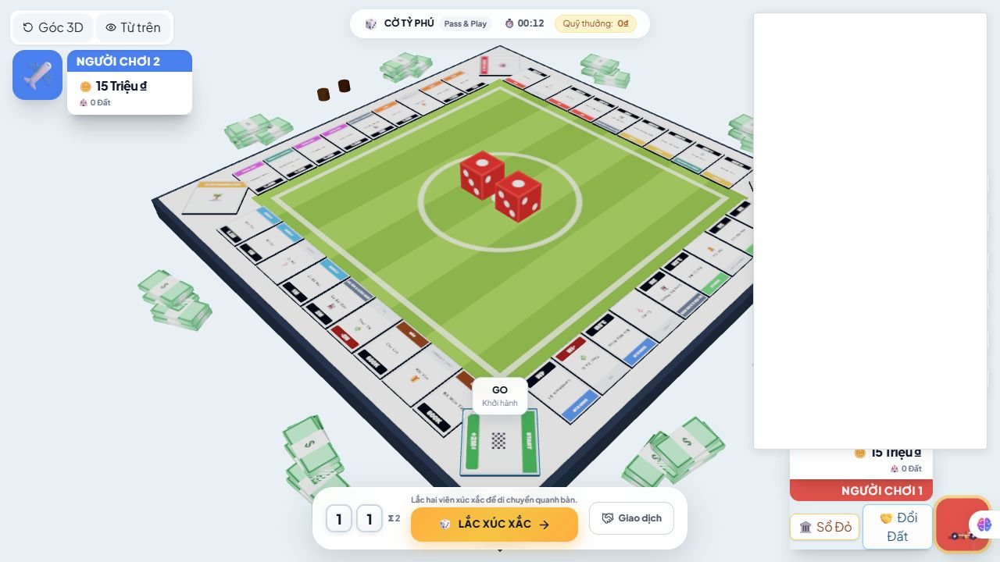

# Review V16 — Sau bản sửa V15, bàn giao Anti

Ngày 08/11/2026. Review mã nguồn local chưa commit, dựa trên HEAD `b5da067`.

**Kết luận: có sửa đúng, nhưng chưa nên deploy bản mới vì có regression làm bỏ qua địa chỉ Redis đã cấu hình.** Lượt này chỉ review, không sửa source game, không commit/push/deploy.

## 1. Những gì đã thay đổi và kiểm tra

So với snapshot V15, có **7 tệp thay đổi**: `package.json`, `server/index.js`, `server/redisRoomStore.js`, `src/App.jsx`, `src/components/GameInterface.jsx`, `src/components/CornerHUD.jsx`, `src/components/Board3D.jsx`. Có thêm `test/reviewV15.test.js`.

| Hạng mục | Kết quả |
|---|---|
| Bộ test hiện tại | **97 ca qua** = 23 legacy + 74 Node runner; 0 fail, 0 cancelled, 0 skipped |
| Build production | Thành công; cảnh báo chunk lớn còn. Board3D 565.19 kB, gzip 142.41 kB |
| Địa chỉ Redis | **Tái hiện lỗi mới**, thử bằng Redis thật riêng tại `127.0.0.1:16391`; không đụng production |
| SUBSCRIBE thất bại | Tái hiện bằng chèn lỗi vào transport giả trong chương trình chẩn đoán; không phải mô phỏng toàn mạng production |
| GUI mới | Mở Vite local `127.0.0.1:3160`, màn hình 1280×720; chơi local hai người, lắc, nộp thuế, chuyển lượt, kiểm tra nút giao dịch |
| Vercel hiện tại | Health vẫn `ok`, `backend: redis`. Entry JS vẫn `index-D_uAc47K.js`; build local mới là `index-PxWp9TmY.js` |

**Không lấy Vercel đang chạy tốt làm bằng chứng bản sửa local kết nối Redis đúng.** Frontend production tại thời điểm kiểm tra chưa khớp build local mới. Không xác định riêng phiên bản backend production chỉ từ tên bundle frontend.

## 2. Lỗi mới cần sửa trước

### V16-R01 — P1: Bỏ sót lưu endpoint, Redis client kết nối sai máy/cổng

**Vị trí:** `server/redisRoomStore.js:22–41`.

Constructor nhận và kiểm tra biến `endpoint`, nhưng không gán nó cho `this.endpoint`. Hàm `_initClients()` mới lại gọi:

```js
createClient({ url: this.endpoint, ... })
```

`this.endpoint` là `undefined`, nên client dùng đích mặc định. Địa chỉ Redis Cloud từ `REDIS_URL` không được chuyển tới client.

**Đã tái hiện với Redis thật:**

1. Redis disposable lắng nghe `127.0.0.1:16391`.
2. Client đối chứng dùng đúng URL trả `PONG`.
3. `new RedisRoomStore({endpoint:'redis://127.0.0.1:16391'})` gọi `ready()` thất bại.
4. Sự kiện lỗi ghi nhận client tìm `::1:6379` và `127.0.0.1:6379`, không phải cổng được yêu cầu.

```json
{
  "storedEndpointType": "undefined",
  "clientOptionUrl": null,
  "controlPing": "PONG",
  "storeReady": false
}
```

**Ảnh hưởng:** khi deploy mã mới, server không sử dụng địa chỉ Redis Cloud đã cấu hình. Trong môi trường không có Redis mặc định ở localhost, online/health sẽ lỗi. Không cần tạo Redis mới, đổi gói hoặc đổi thông tin đăng nhập để chữa lỗi này.

**Anti cần làm:** giữ endpoint đã nhận trên instance trước `_initClients()` và bảo đảm mọi lần tạo lại client đều dùng đúng URL. Không in URL chứa mật khẩu ra log.

**Test cần thêm:** endpoint hợp lệ ở cổng khác mặc định phải kết nối và đọc/ghi được; sai mật khẩu/endpoint phải thất bại; tạo lại client sau gián đoạn vẫn đi đúng đích. Chạy lại Redis integration thật.

### V16-R02 — P2: `ready()` nuốt lỗi SUBSCRIBE rồi báo sẵn sàng

**Vị trí:** `server/redisRoomStore.js:90–96`; fast path ở dòng 61.

Mọi lỗi từ `subscriber.subscribe()` bị bắt và bỏ qua với chú thích `Already subscribed`. Không có kiểm tra nào chứng minh lỗi là do đã đăng ký. Hai kết nối TCP ready không đồng nghĩa kênh sự kiện phòng đã được đăng ký thành công.

**Đã tái hiện bằng fault injection:** cho command/subscriber kết nối thành công, riêng `subscribe()` ném lỗi. `ready()` vẫn resolve dù subscription không thành công. Xem `subscription-failure-results.json`. Đây là phép thử luồng xử lý lỗi bằng transport giả; không khẳng định Redis Cloud hiện đang từ chối SUBSCRIBE.

**Ảnh hưởng khi gặp lỗi đăng ký kênh:** các request có thể tiếp tục đọc/ghi nhưng server không nhận sự kiện từ kênh phòng. `broadcast()` hiện dùng subscriber làm đường nhận sự kiện cả cho client cùng instance, nên người chơi có thể không nhận cập nhật dù thao tác đã ghi vào Redis.

**Anti cần làm:** theo dõi trạng thái subscription riêng; chỉ báo ready khi đã đăng ký kênh thành công. Lỗi thật phải làm readiness thất bại hoặc đi vào quá trình phục hồi, không được nuốt. Xử lý nhiều lời gọi `ready()` đồng thời và reconnect mà không nhân đôi callback.

**Nghiệm thu:** ép SUBSCRIBE thất bại → readiness không báo thành công; khôi phục → hai socket nhận cập nhật đúng một lần. Thử subscriber mất kết nối độc lập với command client.

## 3. Các vấn đề V15 đã sửa đến đâu?

| V15 | Đánh giá V16 | Bằng chứng / phần còn lại |
|---|---|---|
| R01: Redis không tự phục hồi | **Chưa đạt** | Có reconnect/backoff và kiểm tra readiness mới, nhưng phát sinh V16-R01 và V16-R02. Chưa có test thành công rồi cắt/khôi phục Redis thật trong test mới |
| R02: ghế hết hạn chặn start | **Đã sửa kịch bản chính** | `toggle_ready` và `start_game` gọi `expire()`; regression test phòng 3 người còn 2 người hợp lệ vượt qua |
| R03: reject trade cũ bị conflict | **Đã sửa kịch bản chính** | Nhánh reject không yêu cầu game revision cũ; test xác nhận accept cũ bị chặn và reject thành công, xóa offer |
| G01: giá/tên khó đọc | **Cải thiện một phần** | Có dải giá đen chữ trắng, lề an toàn, baseline và bố trí tên mới. Quan sát local vẫn thấy chữ rất nhỏ khi nhìn toàn bàn |
| G03: nút giao dịch lệch trạng thái | **Cải thiện rõ** | Truyền `canTrade` vào CornerHUD, disable + lý do. GUI xác nhận nút góc bị khóa lúc đang lắc và mở lại khi hết xử lý |

Không mở lại hai lỗi R02/R03 chỉ vì vẫn còn backlog khác. Giữ các test đã thêm và mở rộng tình huống khi cần.

### Điểm cần kiểm chứng thêm sau khi sửa Redis

- **Đồng bộ bù sau reconnect:** code hiện chưa có luồng đọc và phát snapshot cho các socket còn nối sau khi subscriber phục hồi. Pub/sub có thể bỏ lỡ sự kiện trong thời gian mất kết nối. Cần test hai instance: chỉ ngắt subscriber của A, B thực hiện action, phục hồi A; người ở A phải tự nhận state mới mà không cần refresh. Đây là khoảng trống từ đọc code, chưa tái hiện đầy đủ end-to-end trong V16.
- **`ready()` chạy đồng thời:** fast path `isReady` chưa phản ánh subscription đang chờ. Thử các request tới đúng lúc kết nối vừa ready nhưng SUBSCRIBE chưa xong.
- **Giới hạn chờ:** thời gian chờ trong `waitForReady()` không tự bao phủ mọi `connect()` await trước đó. Đo thời gian thoát khi đích không phản hồi, không chỉ khi cổng từ chối ngay.
- **Nút/ACK frontend:** `useGameController.js` chưa đổi; ready/chat vẫn chưa nhận ACK ở wrapper như backlog V15. Chưa thử cắt mạng GUI vòng này.
- **Quyền giao dịch:** `App` và `GameInterface` vẫn tính điều kiện riêng; `App.canAct` chưa gồm `connected`. Cần dùng một nguồn quyền thao tác chung và kiểm tra mở modal khi offline. V16 chỉ xác nhận trạng thái lắc trong local, chưa nghiệm thu online GUI.

## 4. Vì sao test xanh vẫn lọt lỗi Redis quan trọng?

Test Redis mới trong `test/reviewV15.test.js:17–35` chỉ kiểm tra endpoint không tới được và lifecycle đóng. Nó không chứng minh một endpoint hợp lệ được dùng đúng.

Với regression hiện tại, cấu hình endpoint sai/đúng đều bị bỏ qua. Máy review không có Redis ở cổng mặc định 6379 nên test “phải thất bại” vẫn qua vì **kết nối nhầm một đích cũng đang thất bại**.

Không cần thêm nhiều test đọc tên biến hoặc kiểm tra chuỗi source. Cần ba test hành vi có ý nghĩa:

1. Redis thật ở cổng khác 6379: ready → write → read → pub/sub thành công.
2. Đang chơi hai instance: cắt rồi nối lại command/subscriber → khôi phục được, không mất đồng bộ, không áp dụng action trùng.
3. Endpoint/subscription hỏng: readiness thất bại trong thời gian giới hạn, không ACK thành công khi luồng cần thiết chưa dùng được.

V16 không chạy lại toàn suite `test:redis`; đã chạy probe Redis thật riêng để chứng minh lỗi endpoint. Không cộng kết quả Redis integration của vòng cũ vào 97 test mới.

## 5. Giao diện có đạt yêu cầu giống ảnh Business Tour chưa?

**Chưa đạt mức có thể chốt mỹ thuật.** Bố cục đã đúng hướng nhưng đợt này chủ yếu sửa texture nhãn, không phải thay thế bộ mô hình/asset, camera hoặc toàn bộ thiết kế.

### Đã tốt hơn

- Giá có nền riêng, tương phản mạnh hơn; không còn đặt số sát mép canvas như trước.
- Có khoảng dành cho mô hình, tên và icon loại tài sản.
- Nút giao dịch ở thẻ góc thể hiện trạng thái khóa thay vì luôn trông bấm được.
- Ván local thử có trừ thuế, cộng quỹ và chuyển lượt phù hợp trạng thái hiển thị.

### Cần làm tiếp theo thứ tự

1. **Độ đọc thực tế:** dải đen rõ hơn nhưng chữ vẫn nhỏ trên cả bàn; tăng font trên texture từ 68 lên 70 px không giải quyết tỷ lệ màn hình. Cần chốt camera, kích thước dải giá, độ rút gọn tên; cân nhắc nhãn cho ô quan trọng/ô được chọn. Giữ inspector cho thông tin đầy đủ.
2. **Chất lượng mô hình:** hoàn thiện silhouette cấp 1–4, vật liệu, bóng tiếp xúc, avatar/quân cờ. Thay nhãn giá không đủ làm bàn có chiều sâu và sống động như ảnh tham chiếu.
3. **Luồng mua nhà:** giữ engine hiện tại, nghiệm thu trên state có đủ cấp nhà và cả bốn cạnh; preview → xác nhận → ACK → trừ tiền một lần → mô hình thật đúng ô. V16 không chơi đủ để xác nhận toàn bộ cấp công trình bằng GUI.
4. **Chuyển động có ý nghĩa:** dựng nhà, chuyển tiền thuê, highlight ô đến; hiệu ứng ngắn sau kết quả hợp lệ. Không che tên, giá hoặc quyết định người chơi.
5. **Responsive sạch:** desktop 1366×768, 1920×1080; điện thoại 390×844, 360×800; 2/4/6 người. V16 chưa test lại mobile, không kết luận mobile đã đạt.

**Giới hạn ảnh review:** môi trường trình duyệt có tiện ích tạo bảng trắng đè bên phải. Bảng đó không thuộc game. Chỉ đánh giá phần bàn không bị che, không dùng ảnh này nghiệm thu bố cục toàn màn hình.



## 6. Việc đưa Anti làm ngay

### Ưu tiên 1 — Khôi phục kết nối Redis đúng và kiểm thử thật

- Sửa V16-R01, V16-R02.
- Thêm test endpoint hợp lệ, subscription thất bại và reconnect; kiểm chứng snapshot sau khi bỏ lỡ sự kiện.
- Chạy `npm test`, `npm run build`, Redis integration thật; ghi rõ pass/fail/skip.
- Giữ cấu hình Redis Cloud/Vercel miễn phí hiện có. Không tạo thêm dịch vụ trả phí hoặc đưa `REDIS_URL` vào frontend/log.

### Ưu tiên 2 — Hoàn thiện giao diện rõ ràng

- Camera/nhãn phải được kiểm tra theo kích thước chữ trên screenshot thực tế.
- Đồng nhất quyền nút và lý do disable giữa HUD, dock và modal.
- Ảnh nghiệm thu cùng kích thước, cùng state: đất trống, 1–4 cấp nhà, Festival, thế chấp, nhiều quân cùng ô và nhiều người chơi.
- Ghi riêng hạng mục đã đổi nhãn và hạng mục thực sự đổi asset/camera; không báo “đã giống Business Tour” chỉ dựa vào comment trong code.

### Ưu tiên 3 — Backlog gameplay vẫn giữ từ V15

Timer lượt/AFK do server kiểm soát, tiến độ thắng, giải thích luật trước trận, trạng thái hết hạn giao dịch và World Tour nếu đã chốt luật. Đây là enhance, không phải lỗi mới đã chứng minh trong V16.

**Điều kiện chốt:** hai thiết bị thật trên hai mạng chơi được sau deploy; bundle mới đúng bản bàn giao; thử nối lại phiên và nâng nhà; không chỉ dùng health xanh để kết luận toàn hệ thống ổn.

## 7. Bằng chứng

- [Probe endpoint Redis thật](docs/review-v16-2026-11-08/redis-endpoint-probe.mjs) và [kết quả](docs/review-v16-2026-11-08/redis-endpoint-results.json). Cần Redis thử riêng cổng 16391. Probe hiện assert hành vi lỗi để chứng minh finding, không phải test xanh cho hành vi đúng.
- [Probe SUBSCRIBE thất bại](docs/review-v16-2026-11-08/subscription-failure-probe.mjs) và [kết quả](docs/review-v16-2026-11-08/subscription-failure-results.json). Dùng transport giả trong bộ nhớ, không sửa source.
- [Log test](docs/review-v16-2026-11-08/tests.txt), [log build](docs/review-v16-2026-11-08/build.txt).
- [Snapshot source hash, health và bundle local/production](docs/review-v16-2026-11-08/validation.json).

Các dịch vụ local phục vụ review đã dừng; Redis production, biến môi trường Vercel và source game không được chỉnh trong vòng review này.
