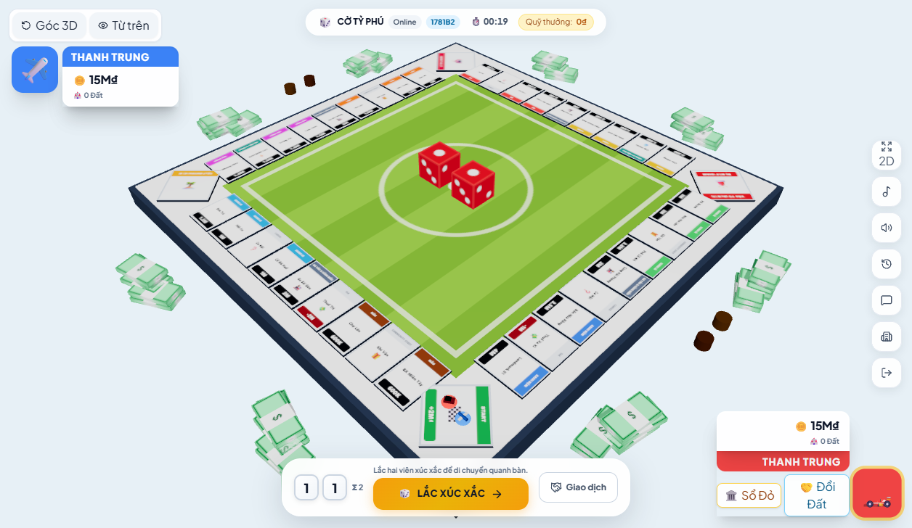

# Review V25 — Giao diện mới và chất lượng bằng chứng

Ngày 08/11/2026. **Chỉ review, không sửa source game, commit/push hoặc deploy.**

## Kết luận

Đợt này đã có thay đổi mỹ thuật thật: mô hình nhà/biệt thự/Landmark chi tiết hơn, bóng tiếp xúc và animation dựng nhà; có bộ ảnh desktop/mobile và báo cáo trình duyệt đi kèm. Không còn là đợt chỉ sửa chat như các vòng gần đây.

**127 test thường qua, build thành công.** Chưa phát hiện regression mới được chứng minh trong luật chơi/resume. Tuy vậy, **chưa chốt được yêu cầu “rõ như Business Tour”**: ảnh hiện có vẫn cho thấy chữ nhỏ, bàn mobile chiếm phần hạn chế giữa nhiều khoảng trống, nút công cụ đè vùng bên phải của bàn. Báo cáo browser cũng chưa đủ chặt để coi mọi hạng mục đã đạt.

## Phạm vi và kết quả

| Hạng mục | Kết quả / giới hạn |
|---|---|
| Test chạy lại trong V25 | **127 qua** = 23 legacy + 104 Node runner; 0 fail/cancelled/skip |
| Build chạy lại | Thành công, còn cảnh báo chunk lớn |
| So với snapshot V24 | Đổi hook controller, GameInterface, Board3D, game.css, App; thêm hai script browser/capture và thư mục bằng chứng |
| Ảnh | Đã mở và xem `desktop_board_overview_live.png`, `mobile_board_overview_live.png` trong workspace |
| Báo cáo browser | Đã đọc JSON và script do đợt sửa mới cung cấp; **không tự chạy lại script browser trong V25** |
| Redis/production | Không chạy lại Redis integration, không xác nhận deploy mới |

Ảnh và JSON mới là bằng chứng đi kèm cần đánh giá, không được ghi thành phiên trình duyệt do reviewer vừa tự thực hiện. Chưa có hash source tại thời điểm chụp để chứng minh tuyệt đối ảnh khớp toàn bộ snapshot đang review.

## Điểm tốt mới

- Nhà cấp thấp và Landmark cao có silhouette phân biệt tốt hơn trong ảnh desktop; màu mái thể hiện chủ và chân công trình có thêm chi tiết.
- Code có bóng tiếp xúc, animation rơi/nảy khi dựng công trình. Chưa đo FPS hoặc nghiệm thu mọi cấp/animation trên điện thoại.
- Có bằng chứng chat hai người cùng tên, giờ hiển thị, badge và cuộn; JSON báo các bước này thành công. Việc tách chat/log cũng đã được ghi nhận trong báo cáo cung cấp.
- Vòng kiểm thử hiện tại không lặp timeout V23. Không lấy một lần qua để bảo đảm test mạng không bao giờ chập chờn.

## G01 — P2: Độ đọc và tỷ lệ bàn mobile chưa đạt yêu cầu sản phẩm

**Bằng chứng:** ảnh mobile đi kèm có viewport được báo cáo 390×844; ảnh raster lớn hơn theo tỷ lệ chụp. Không dùng kích thước raster như kích thước CSS.

Ảnh cho thấy:

- Nhiều khoảng trống phía trên/dưới bàn; nhãn tên và giá rất nhỏ ở góc toàn bàn.
- Dãy công cụ bên phải che một phần vùng bàn/ô cạnh phải.
- Thẻ người chơi cao, tiền bị xuống dòng riêng ký hiệu đồng; tooltip GO lớn so với các ô và quân cờ.

Ảnh desktop rõ hơn và công trình đẹp hơn, nhưng tên/giá vẫn nhỏ trên nhiều ô. Đây là vấn đề nghiệm thu UI quan sát được trên ảnh, không phải bằng chứng luật game sai.

**Anti nên làm:** thiết kế vùng chơi mobile sau khi trừ HUD/dock; thu gọn HUD, gom công cụ vào menu và giữ vùng chạm; chọn camera/zoom khởi đầu theo vùng trống thực tế. Cho phép chạm ô để đọc giá/thuê rõ; không bắt 40 tên dài đều đọc được cùng lúc trên màn hình nhỏ. Kiểm tra tooltip không che quân/ô đang thao tác.

**Nghiệm thu:** cùng state có đủ cấp nhà trên desktop 1366×768 và mobile 390×844/360×800; không có nút nổi che ô cần bấm, giá ô chọn đọc ngay được, mở bàn phím/chat không khóa hành động chính. Chụp trước/sau cùng state để so sánh.

## Q01 — P2: `overallSuccess` của báo cáo browser chưa chứng minh bàn đạt

**Vị trí:** `test/browserVerificationV24.js:547–580` và `docs/review-v24-evidence/browser-verification-v24.json`.

- `boardVerification` trong JSON vẫn `{}` nhưng `overallSuccess` là `true`; biểu thức thành công không yêu cầu kết quả kiểm tra bàn.
- Tính `camBelowHud`/`camAboveTurn` mặc định `true` khi thiếu element. Vì vậy chọn sai selector hoặc không tìm được HUD có thể vẫn báo đạt.
- `overallSuccess` yêu cầu `camBelowHud` nhưng không bao gồm `camAboveTurn`.
- `camRect`, `hudRect`, `turnRect` được lưu thành `{}` do trả DOMRect trực tiếp; mất tọa độ để kiểm tra lại từ file.

**Ảnh hưởng:** log thành công có thể tạo cảm giác toàn bộ board/mobile đã nghiệm thu, dù tiêu chí chưa thực sự được kiểm tra hoặc không còn dữ liệu đối chiếu. Không phủ nhận những bước chat có dữ liệu cụ thể.

**Anti cần sửa:** fail khi thiếu element bắt buộc; serialize rect thành các trường số hoặc `toJSON()`; đưa các điều kiện bàn/HUD/đáy màn hình thật sự vào kết luận. Với mục chưa thực hiện, báo `not_checked` thay vì `true`. Lưu commit/source hash, viewport/DPR và kết quả từng tiêu chí cùng ảnh.

## Q02 — Cần tách fixture hình ảnh khỏi bằng chứng mua nhà thật

**Vị trí:** `test/browserVerificationV24.js:496–504`, `src/App.jsx:26`, phần trả controller của `src/hooks/useGameController.js`.

Script thêm nhà bằng `window.__CONTROLLER__.setGame(...)`. Điều này thay React state để tạo cảnh chụp; không phải action mua/nâng nhà qua reducer/server. `gameRef.current` của controller không được cập nhật bởi setter thô này, nên cảnh UI và state dùng để dispatch có thể lệch nhau sau khi inject.

**Không dùng ảnh fixture để chứng minh:** quyền xây đúng, tiền đã trừ đúng, Landmark đạt đúng điều kiện hoặc hai người đồng bộ nhà sau mua. Fixture hợp lệ cho việc xem mỹ thuật nếu được ghi nhãn rõ.

**Anti nên làm:** tách cảnh demo mỹ thuật khỏi trận online đang kiểm thử. Nếu cần chứng minh mua nhà, tạo state hợp lệ ở backend thử và thực hiện action thật, so tiền/owner/tier/revision trên hai client. Bỏ hoặc giới hạn `window.__CONTROLLER__`/setter debug trong development trước khi chốt production; không cần công khai setter thô chỉ để chụp ảnh. Server vẫn là nơi xác nhận action, không có bằng chứng từ đây rằng client có thể sửa Redis trái phép.

## Thứ tự làm tiếp

1. Sửa chất lượng báo cáo browser: tiêu chí bắt buộc, rect đầy đủ, nhãn fixture và source hash.
2. Chỉnh tỷ lệ bàn/HUD/công cụ mobile và độ đọc tên/giá; nghiệm thu bằng ảnh mới cùng state.
3. Kiểm tra mua nhà thật, resume khi đang chọn cấp, ACK mất/replay và hai client cùng thấy công trình.
4. Đo FPS/bộ nhớ trên điện thoại với nhiều Landmark và animation; chưa có số đo để kết luận mô hình mới làm game chậm.
5. Chốt online trên hai thiết bị/hai mạng và đối chiếu bản deploy. Giữ Vercel/Redis miễn phí, chưa cần đổi hosting.

Không mở lại các lỗi resume/chat đã đóng nếu chưa có regression. Trọng tâm vòng tiếp theo nên là nghiệm thu bàn rõ và dữ liệu chứng minh đầy đủ, thay vì thêm chi tiết mô hình trong khi mobile vẫn khó đọc.

## Bằng chứng

- [Log 127 test](docs/review-v25-2026-11-08/tests.txt), [build](docs/review-v25-2026-11-08/build.txt).
- [Snapshot source](docs/review-v25-2026-11-08/validation.json).
- [Báo cáo browser được cung cấp](docs/review-v24-evidence/browser-verification-v24.json).
- [Ảnh desktop được cung cấp](docs/review-v24-evidence/desktop_board_overview_live.png), [ảnh mobile được cung cấp](docs/review-v24-evidence/mobile_board_overview_live.png).

Không chỉnh source game, tài khoản hoặc cấu hình dịch vụ production trong V25.
