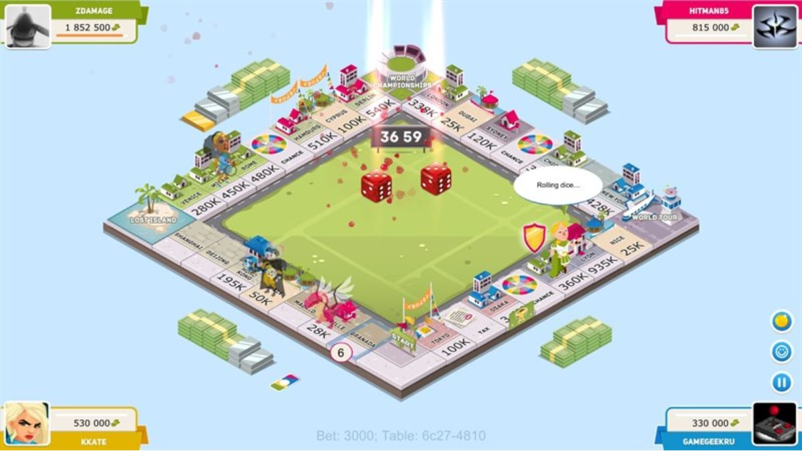

# Review lần 2: online trên Vercel và kế hoạch nâng cấp bàn cờ

**Ngày:** 06/11/2026. **Kiểm tra production gần nhất:** 12:37 giờ Việt Nam.

**Code được xem:** commit 2016f20 và thay đổi bỏ đấu giá, hiện đã nằm trong commit **53a7caf**. **Website:** [monopoly-silk-ten.vercel.app](https://monopoly-silk-ten.vercel.app).

## 1. Kết luận cho chủ dự án

**Bản mới có tiến bộ thật, nhưng hiện người ở nơi khác chưa thể dùng link Vercel này để tạo/vào cùng phòng online.** Website truy cập công khai được và chơi local/bot được; phần phòng online chưa kết nối được tới server.

**Bàn cờ chưa đạt độ rõ và sinh động của ảnh Business Tour bạn gửi.** Vấn đề không chỉ nằm ở “thiếu model đẹp”: camera mặc định cắt bàn, chữ trên ô quá nhỏ, fog làm nhạt phần xa, pipeline màu/ánh sáng cần kiểm tra và công trình còn đơn giản. Board3D.jsx chưa được sửa trong nhóm thay đổi lần này.

Đề xuất thực hiện hai nhánh công việc:

1. **Làm online hoạt động đúng:** nối backend thật, rồi sửa quyền điều khiển và đồng bộ ván.
2. **Làm bàn cờ rõ trước, sinh động sau:** camera → chữ → màu/ánh sáng/bóng → công trình/nhân vật → animation.

Tài liệu này là review và kế hoạch bàn giao. Đợt kiểm tra không sửa gameplay, không thay biến môi trường hoặc deploy thay người dùng.

## 2. Đã kiểm tra gì?

| Hạng mục | Kết quả |
| --- | --- |
| npm test trên bản local mới | **18/18 bài test vượt qua**; trước đây là 11 |
| npm run build | Thành công; JS 970,87 kB, gzip 262,49 kB; CSS 53,14 kB |
| Website Vercel qua HTTP | Truy cập được, status 200 |
| Tạo phòng trên UI production | Bấm tạo nhưng không chuyển sang phòng chờ, không nhận mã phòng |
| Socket.IO production, transport polling | Không kết nối được: server error |
| Socket.IO production, transport websocket | Không kết nối được: websocket error |
| Server local riêng, hai Socket.IO client | Tạo/vào phòng được; server đã chặn bắt đầu khi khách chưa ready |
| Thử sửa state bằng client khách trên server local | Vẫn được chấp nhận, gồm tiền 999.999.999, nhà cấp 99 và tự khai thắng |
| Probe AI trên nhóm màu đầy đủ | Giới hạn xây cấp 4 và thanh lý không bán lặp đã được sửa |
| Probe handler mua sau GO | Vẫn tái hiện mất vị trí/lương |
| Probe trả thuê thiếu tiền rồi thế chấp | Vẫn tái hiện chủ đất nhận thiếu tiền |
| UI 1440×900 và 390×844 | Bàn bị cắt ở góc nhìn mặc định; dock mobile vẫn có nút ra ngoài màn hình |

Phân biệt phạm vi: các probe handler trích đúng hàm từ App.jsx nhưng chạy với state/setter giả lập, không thay thế kiểm thử một ván hoàn chỉnh. Chưa chứng nhận chơi trọn ván giữa hai thiết bị dùng hai mạng Internet khác nhau, vì endpoint production chưa kết nối được. Chưa đo FPS/GPU trên điện thoại thật.

Trong phiên review, production đổi asset từ index-DD9PAhhj.js sang **index-D4uBCUlT.js**, trùng tên asset build local đã kiểm tra. Kết luận online ở trên dựa trên lần kiểm tra lại asset mới, không chỉ bản deploy đầu phiên.

Bằng chứng đã lưu:

- [Kết quả HTTP và Socket.IO](docs/review-2026-11-06/online-check-result.json).
- [Script kiểm tra lại kết nối](docs/review-2026-11-06/check-online.mjs).
- [Ảnh desktop production](docs/review-2026-11-06/vercel-desktop.jpg).
- [Ảnh mobile production](docs/review-2026-11-06/vercel-mobile.jpg).
- [Tọa độ nút trên mobile](docs/review-2026-11-06/mobile-layout.json).
- [Ảnh Business Tour tham chiếu do người dùng cung cấp](docs/review-2026-11-06/business-tour-reference.png).

Lưu ý ảnh chụp: trình duyệt thử có chèn một khung trắng/nhắc đồng ý ngoài #root. **Không tính khung này là lỗi của game.** Nhận xét bố cục dựa thêm vào DOM của game và code.

## 3. Các điểm đã cải thiện so với review trước

Không nên phủ nhận phần đã sửa, nhưng cũng không coi comment “FIX” hoặc commit message là bằng chứng hoàn tất.

| Mục cũ | Trạng thái review lại |
| --- | --- |
| F01: server tin client | **Chưa sửa phần cốt lõi.** Đã kiểm tra ready; nhận state tùy ý vẫn còn |
| F02: trade tự thực hiện | **Đã cải thiện local:** có confirm/reject và bot định giá. Online chưa có chấp thuận đúng người nhận |
| F03: props modal xây sai | **Đã sửa hợp đồng props và tính lại chi phí.** Cần đưa validator về engine dùng chung |
| F04: cộng số dư âm hai lần | **Đã sửa điều kiện maxLiquid < 0** và tách giá trị thanh lý |
| F05: AI xây vượt/bán lặp | **Đã sửa trong planner**, xác nhận lại với nhóm màu đầy đủ |
| F06: state cũ sau GO/tù | **Chưa xong.** Có thêm tham số nhưng một số nơi gọi không truyền state mới |
| F07: nợ/thuê tạo tiền | **Sửa một phần nhưng phát sinh trả thiếu chủ nợ**, xem R03 |
| F08: đấu giá | **Đã bỏ khỏi luồng người chơi theo commit mới.** Không tự yêu cầu khôi phục cho mode Arcade |
| F09: action thẻ thiếu | Đã thêm nearest railroad, repair và kết thúc pha thẻ trả tiền; còn thiếu hệ số thuê đặc biệt của thẻ tàu |
| F10: bot chờ bấm thẻ/tù | Đã thêm tự xử lý thẻ và thử ra tù; còn cần chạy ván toàn bot và kiểm tra nợ |
| F11: online/rejoin | **Vẫn thiếu phase, xác thực người chơi, reconnect/rejoin** |
| F12: ga/tiện ích/cấp nhà lẫn | Đã tách mua ga/tiện ích và sửa HUD khách sạn; Board 2D/Deed vẫn có chỗ dùng cấp 5 |
| F13: thắng sau đổi chủ | Đã bổ sung gọi kiểm tra sau trade và chuyển tài sản phá sản |
| F14: HUD giả/thiếu người | Đã map toàn bộ người chơi, đồng hồ thật, jackpot 0 hiện 0; reset ván/sync timer vẫn thiếu |
| F15: responsive | **Còn lỗi tràn dock**, xác nhận trên production |
| F16: render 3D | **Chưa có thay đổi tương ứng**, các vấn đề camera/render/tài nguyên còn |
| F17: kiến trúc/test/UX nền | Có thêm 7 test, nhưng luật vẫn nằm nhiều trong App.jsx; chưa có engine action/reducer hoàn chỉnh |

Điểm tích cực nên giữ: chủ đề Việt Nam, các chế độ vào chơi, chế độ 2D, âm thanh, bot có chiến thuật cơ bản, modal giao dịch mới và nền kiểm thử hiện tại.

## 4. Người ở chỗ khác tham gia được chưa?

### 4.1. Hiện tại: chưa chơi chung phòng online được

Kiểm tra trực tiếp trên domain người dùng cung cấp:

| URL/kiểu kết nối | Kết quả thực tế | Ý nghĩa |
| --- | --- | --- |
| GET / | 200, text/html | Frontend hoạt động |
| GET /api/health | 200, text/html, trả trang game | Không phải API health của backend |
| GET /socket.io/?EIO=4&transport=polling | 200, text/html, trả trang game | Không phải handshake Engine.IO |
| Socket.IO polling | server error | Không thiết lập được kết nối |
| Socket.IO websocket | websocket error | Không nâng cấp được kết nối |

**Status 200 không chứng minh online hoạt động.** Trong trường hợp này, fallback SPA đang trả HTML cho cả đường API/socket.

Bản JavaScript production chứa lời gọi socket dạng:

    io(undefined, { transports: ['websocket', 'polling'], reconnectionAttempts: 5 })

Trong bundle minify, undefined hiện thành void 0. Điều này cho thấy bản đang chạy dùng domain hiện tại làm đích kết nối; chưa có URL backend riêng được đưa vào vị trí đó.

Nguyên nhân trong repo:

- vercel.json chỉ cấu hình build ra dist và rewrite tất cả đường dẫn về index.html.
- server/index.js là một tiến trình Node/Express/Socket.IO riêng; cấu hình static hiện tại không làm tiến trình này tự chạy.
- App.jsx:112 dùng VITE_SOCKET_URL hoặc domain hiện tại.
- Proxy localhost:3001 trong vite.config.js chỉ nằm ở cấu hình dev; nó không tự xuất hiện trên production.

**Kết luận có thể khẳng định:** người khác mở link xem/chơi bot được; việc tạo phòng chung trên bản hiện tại chưa hoạt động. Chưa có bằng chứng backend riêng đã deploy ở một domain khác.

### 4.2. Cập nhật quan trọng về Vercel

Không nên tiếp tục nói tuyệt đối “Vercel không hỗ trợ WebSocket”. Tài liệu chính thức được kiểm tra ngày 06/11/2026 đã có hướng dẫn WebSocket/Socket.IO cho Vercel Functions. Vấn đề của repo hiện tại là cấu hình deploy static chưa tạo backend đó. Nguồn: [Vercel WebSockets](https://vercel.com/docs/functions/websockets), [thông báo hỗ trợ](https://vercel.com/changelog/websocket-support-is-now-in-public-beta).

### 4.3. Hướng A — Giữ frontend Vercel, thêm backend Node riêng

Đây là hướng ít thay đổi nhất với cấu trúc Express/Socket.IO hiện tại.

    Người chơi A, B, C ở các mạng khác nhau
                    |
                    v
        Frontend: monopoly-silk-ten.vercel.app
                    |
                    v
        Backend Node công khai qua HTTPS/WSS
                    |
                    v
        Phòng, luật, trạng thái và dữ liệu khôi phục

Các việc cụ thể:

1. Deploy backend dưới dạng **Web Service Node**, không phải static site. Root của service là thư mục có package.json; entry hiện tại là server/index.js, start script là npm start.
2. Có thể dùng Render cho tiến trình này; tài liệu của họ mô tả triển khai Express và nhận WebSocket từ Internet. Cần chọn cấu hình vận hành phù hợp, không mặc định mọi gói miễn phí đều chạy liên tục. Nguồn: [Render Express](https://render.com/docs/deploy-node-express-app), [Render WebSockets](https://render.com/docs/websocket).
3. Kiểm tra domain backend: /api/health phải trả JSON; Socket.IO handshake phải thành công.
4. Trên Vercel, đặt VITE_SOCKET_URL bằng **URL HTTPS backend thật**, ví dụ tên miền dịch vụ vừa tạo. Không dùng localhost hoặc IP LAN cho người chơi bên ngoài.
5. Cài biến cho môi trường Production; nếu dùng Preview để test thì cấu hình Preview riêng.
6. **Build/deploy frontend lại sau khi đổi biến.** Vite thay import.meta.env vào bundle lúc build; đổi biến xong không làm bundle cũ tự đổi. Nguồn: [Vite: Env Variables and Modes](https://vite.dev/guide/env-and-mode.html).
7. Cấu hình origin frontend được phép trên backend; xác thực người gửi lệnh vẫn là việc riêng, không dựa vào CORS để chống sửa state.
8. Có trạng thái “Đang kết nối / Đã kết nối / Mất kết nối” trên lobby; tạo phòng chỉ bật khi socket sẵn sàng, có timeout và lỗi dễ hiểu.

Nếu backend giữ Map trong RAM, một instance có thể đủ thử nghiệm ban đầu. Tuy nhiên restart/redeploy làm mất phòng; cần lưu snapshot/session trước khi quảng bá khôi phục ván. Khi chạy nhiều instance phải có cơ chế chia sẻ và phối hợp state.

### 4.4. Hướng B — Giữ cả backend trên Vercel

Có thể nghiên cứu theo tài liệu hiện hành, nhưng đây là một thay đổi kiến trúc thật:

- Thêm Function backend và route socket riêng, không rewrite route đó về index.html.
- Dùng path Socket.IO đúng với Function, và websocket transport theo hướng dẫn Vercel.
- Có xử lý kết nối đóng theo thời lượng Function; lưu room/presence/state ở bên ngoài tiến trình vì lần nối lại có thể vào instance khác.
- Áp dụng máy chủ quyết định luật, phiên bản state và định danh người chơi bền.

Đây là đề xuất triển khai, chưa được áp dụng hoặc xác nhận trên tài khoản Vercel của người dùng. Chi tiết transport, reconnect và state: [tài liệu Vercel](https://vercel.com/docs/functions/websockets).

**Khuyến nghị:** chọn hướng A nếu muốn sớm giữ nguyên backend hiện tại để chơi với bạn bè; chọn hướng B nếu ưu tiên mọi dịch vụ trên Vercel và chấp nhận thiết kế lại phần backend/persistence.

### 4.5. Kiểm tra lại sau deploy

Từ root repo trên máy hiện tại:

    rtk proxy node docs/review-2026-11-06/check-online.mjs

Nếu backend riêng:

    rtk proxy node docs/review-2026-11-06/check-online.mjs https://monopoly-silk-ten.vercel.app https://BACKEND-THAT

Script còn nhận đối số thứ ba sau backend là socket path nếu dùng Function. Ví dụ path theo kiến trúc mới có thể là /api/socket-io/socket.io; phải khớp code triển khai thật.

Script chỉ đọc HTTP/thử handshake, không tạo phòng hoặc gửi hành động game. Nó ghi online-check-result.json và trả exit code 1 khi cả hai transport đều không kết nối được. **Handshake thành công vẫn chưa chứng minh một ván nhiều người đồng bộ đúng.**

## 5. Những lỗi còn cần sửa trước khi coi online hoàn chỉnh

Quy ước: **P0** chặn phát hành online công khai; **P1** làm sai ván hoặc quyền hành động; **P2** làm giảm độ rõ, khả năng dùng hoặc độ bền.

### R01 — P0: Server vẫn nhận state tùy ý từ client

server/index.js:159–169 chỉ kiểm tra room đang chơi rồi spread updatedGameState vào state cũ. Comment “Sanitize & merge” không phải kiểm tra dữ liệu.

Probe hai client local xác nhận: sau khi ready và bắt đầu đúng quy trình, client khách vẫn sửa được tiền thành **999.999.999**, nhà thành **99** và tự khai winner.

**Sửa:** client gửi lệnh; server xác định actor từ session, kiểm tra lượt/phase/giá/tiền/sở hữu và tự tạo state mới. Xúc xắc/thẻ online cũng do server quyết định. Có actionId/revision để tránh tính hai lần hoặc ghi đè state mới bằng bản cũ.

**Đạt khi:** payload tự sửa tiền/nhà/winner bị từ chối; sai lượt không làm đổi state.

### R02 — P1: Qua GO rồi bot mua vẫn dùng danh sách người chơi cũ

App.jsx:626 đã có playersList, nhưng các lời gọi tại dòng 545 và 609 không truyền currentPlayersList mới. Hàm quay về players của closure cũ. Đường buyProperty cho ga/tiện ích cũng cần xem lại tương tự.

Probe đúng handler hiện tại:

- Trước di chuyển: ô 39, tiền 1 triệu.
- Sau qua GO: ô 1, tiền 3 triệu.
- Mua cấp 1 giá 600.000.
- **Mong đợi:** ô 1, tiền 2,4 triệu.
- **Thực tế:** ô 39, tiền 400.000.

**Sửa:** truyền state sau di chuyển xuyên suốt hoặc, tốt hơn, xử lý cả transition bằng reducer/engine. Không để animation/setTimeout quyết định nguồn dữ liệu kinh tế.

### R03 — P1: Thanh lý xong nhưng chủ đất nhận thiếu tiền thuê

App.jsx:1085 chỉ cộng actualTransfer bằng tiền mặt đang có cho chủ đất, nhưng trừ toàn bộ khoản thuê khỏi con nợ. handleDebtCrisis sau đó thanh lý và đưa con nợ hết âm, **không trả phần còn thiếu cho chủ nợ**.

Probe thực tế:

- Bot có 400.000, nợ tiền thuê 1.000.000.
- Bot có ô 37, thế chấp được 1.750.000.
- Sau xử lý: bot còn 1.150.000, chủ đất chỉ nhận 400.000.
- Chủ đất phải nhận đủ 1.000.000 vì con nợ huy động đủ tiền; **600.000 bị mất khỏi luồng thanh toán**.

**Sửa:** debtContext lưu debtorId, creditorId, totalDue, paid và remaining. Sau mỗi lần thanh lý phải thanh toán phần còn thiếu; đóng debtContext chỉ khi trả đủ hoặc phá sản theo luật. Mọi khoản thu/chi đi chung luồng này.

### R04 — P1: Ra tù của người thật còn dùng state cũ

Nhánh bot đã truyền updated vào movePlayer. Nhánh người thật tại App.jsx:1825 và 1837 vẫn gọi ba tham số ngay sau setPlayers(updated).

Vì movePlayer mặc định lấy players của render trước, trạng thái inJail hoặc tiền trước khi nộp phạt có thể được ghi trở lại.

**Sửa:** dùng một action ra tù/di chuyển cho cả người và bot. Kiểm tra đủ tiền khi bắt buộc nộp phạt; khoản phạt thiếu tiền phải đi qua giải quyết nợ.

### R05 — P1: Chấp thuận trade online chưa thuộc đúng người nhận

App.jsx:1944 chỉ đặt pendingTradeOffer ở client gửi. TradeConfirmModal cũng được dựng ở client đó; pendingTradeOffer không được đồng bộ sang người nhận.

Modal xác nhận local là cải thiện thật. Nhưng online phải gửi offer tới đối thủ và chỉ đối thủ được accept/reject; không thể coi việc mở confirm ở máy người gửi là đồng thuận hai bên.

**Sửa:** lưu offer trên server, gửi thông báo người nhận, kiểm tra actorId khi accept, xác minh lại tiền/chủ đất rồi thực hiện nguyên tử.

### R06 — P1: Đồng bộ và reconnect chưa đủ dữ liệu

App.jsx:197–208 và 136–144 chưa đồng bộ doublesCount, pending trade, debt context, các phase/modal, totalTurnsCount hoặc thời gian bắt đầu ván. Sổ đỏ tại App.jsx:1856–1916 vẫn sửa tiền/tài sản mà không gửi state tương ứng.

Mất kết nối vẫn xóa người khỏi room; socket.id là danh tính; chưa có join lại ván đang chơi. Rời phòng chờ disconnect socket nhưng chưa có luồng kết nối lại rõ. Chưa có chặn thao tác theo socketId trong luồng chơi chính.

**Sửa:** snapshot chuẩn đầy đủ, player/session ID bền, reconnect/rejoin có thời gian chờ; server gửi phase và quyền hành động. UI chỉ bật điều khiển của chính người đang được phép.

### R07 — P1: Ô “Du lịch” trong hình vẫn đưa người chơi vào tù

Board3D.jsx:91–94 vẽ ô 30 là **DU LỊCH (TOUR)**. boardData.js vẫn định nghĩa ô 30 là go_to_jail; App.jsx:438 xử lý giam tại ô 10.

Đây là lệch giữa thông tin nhìn thấy và hành vi thật, ảnh hưởng trực tiếp chiến thuật.

**Sửa:** nếu muốn World Tour như đặc tả nội bộ/ảnh tham chiếu thì triển khai cơ chế chọn điểm đến; nếu chưa làm thì hiển thị đúng chức năng hiện tại. Chốt cùng ruleset thay vì chỉ đổi tên texture.

### R08 — P2: Những phần chưa hoàn thiện khác

- Bắt đầu ván chưa reset elapsedSeconds, totalTurnsCount, dice và toàn bộ pending UI state tại một nơi.
- Thẻ tàu gần nhất đã di chuyển, nhưng chưa truyền hệ số **thuê gấp đôi** như mô tả ch_4.
- Thẻ thu/trả nhiều người vẫn trừ trực tiếp, chưa giải quyết nợ của từng bên.
- Festival chưa có vòng đời chuyển/xóa rõ; Free Parking Jackpot vẫn được quảng bá nhưng ô đó đang xử lý lễ hội/tài trợ.
- Board.jsx:73 và DeedModal.jsx:166 vẫn nhận khách sạn ở cấp 5, trong khi engine mới lấy cấp 4.
- Bỏ đấu giá khỏi Arcade là lựa chọn sản phẩm; nên dọn import/state/handler đấu giá không còn dùng và cập nhật README. Không gọi đó là đã hoàn thiện luật Classic.
- App.jsx gần 2.000 dòng; thêm tên “engine” trong commit chưa đồng nghĩa đã tách engine action/reducer.

## 6. Vì sao bàn hiện tại nhìn nhạt, mờ và thiếu sức sống?

### 6.1. Hướng hình ảnh nên theo

Ảnh bạn gửi là phong cách **stylized 2.5D/isometric**: rõ khối, rõ giá tiền, nhà có hình dáng dễ phân biệt, bóng giúp vật thể bám mặt bàn, nhân vật/hiệu ứng gắn với hành động.

Mục tiêu phù hợp là **rõ, sáng, có chiều sâu và hoạt động có chủ đích**. Không cần chuyển sang đồ họa photorealistic nặng để đạt cảm giác này.

| Thành phần | Ảnh tham chiếu | Bản hiện tại |
| --- | --- | --- |
| Khung bàn | Nhìn đủ bốn góc, có khoảng trống quanh bàn | Zoom/góc mặc định làm cạnh gần và một phần bàn bị cắt |
| Chữ giá | Là thông tin nổi bật, ít chi tiết cạnh tranh | Chữ nhỏ trong texture, co nhỏ hơn ở phía xa |
| Khối công trình | Dễ phân biệt nhà, biệt thự, khách sạn, ô đặc biệt | Cấp 1–3 chủ yếu lặp lại cùng mô hình nhà nhỏ |
| Ánh sáng | Có tương phản và bóng tiếp xúc rõ | Màu có cảm giác bị nâng sáng/nhạt, bóng cạnh bàn chưa rõ |
| Nhân vật | Có silhouette riêng và phản ứng | Token đơn giản, ít biểu cảm |
| Sức sống | Cờ, nhân vật, lễ hội, tiền, xúc xắc hỗ trợ sự kiện | Có animation nhưng một số đọc state cũ; đồ trang trí chưa phục vụ thông tin |
| HUD | Gọn, nhường vùng bàn | Nhiều lớp HUD/dock/nút, có chồng lấn |

**Không thấy một pass blur/DOF toàn cảnh trong Board3D.jsx.** Vật liệu mặt ô cũng không bị đặt opacity thấp. Vì thế không nên sửa bằng cách “tắt blur toàn trang”. Cần tách ba vấn đề: chữ thiếu pixel hiển thị, tương phản bị giảm và mô hình thiếu chi tiết/hành vi.

### 6.2. Nguyên nhân cụ thể trong code

1. **Camera chưa fit bàn vào vùng chơi.** Board3D.jsx:581 dùng radius 29, dòng 596 dùng PerspectiveCamera 45°. Không có bước tính bounding box và chừa vùng HUD.
2. **Chữ nhỏ cả về nguồn lẫn kích thước chiếu.** Texture mặt ô chỉ 256×380; tên 24 px, giá 30 px trong canvas. Khi ô còn vài chục pixel trên màn hình, chữ chỉ còn vài pixel chiều cao. Chỉ tăng độ phân giải texture mà giữ tỷ lệ chữ không đủ giải quyết.
3. **Fog đang tác động lên vùng bàn.** Dòng 593: Fog màu trời từ khoảng cách 32 tới 95. Camera ở radius 29 khiến vùng xa của bàn có thể đã đi vào fog; kết quả giảm tương phản. Cần so ảnh tắt/bật để đo mức ảnh hưởng. Cơ chế fog theo khoảng cách: [Three.js Fog](https://threejs.org/docs/pages/Fog.html).
4. **Canvas texture màu chưa được gắn colorSpace rõ ràng.** createTileTexture, texture cỏ và xúc xắc chưa gắn SRGBColorSpace. Đây là cấu hình cần sửa/kiểm chứng, không khẳng định nó là nguyên nhân duy nhất. Three.js yêu cầu khai báo color space thích hợp cho texture chứa màu: [Texture](https://threejs.org/docs/pages/Texture.html).
5. **Ánh sáng/exposure chưa được hiệu chỉnh theo texture đúng.** Ambient 1.2, directional 2.0 và exposure 1.15 cùng tồn tại. Phải sửa màu trước rồi cân lại độ tương phản, tránh giảm/tăng ngẫu nhiên từng số.
6. **Shadow camera chưa phủ bàn.** Chỉ tăng map lên 2048, chưa đặt frustum cho mặt bàn khoảng 26 đơn vị. Mã Three.js đang cài tạo DirectionalLightShadow với camera mặc định -5…5, nhỏ hơn bàn; tăng độ phân giải không tự tăng vùng được đổ bóng.
7. **Có lỗi animation đọc state cũ.** Vòng render nằm trong useEffect([]) nhưng đọc isRolling. Giá trị mới của prop không tự đi vào closure đó.
8. **Mesh/texture chưa có vòng đời tốt.** group.clear() bỏ mesh khỏi group nhưng không dispose; đổi dice material chưa giải phóng material cũ. Mỗi lần players thay đổi lại dựng lại toàn bộ công trình.

## 7. Kế hoạch làm bàn cờ rõ nét và sinh động

### G01 — Ưu tiên 1: sửa camera và bố cục

**Đích:** mở ván là nhìn đủ bàn, không phải kéo/zoom mới tìm được các góc.

- Dùng OrthographicCamera cho chế độ xem mặc định, giữ Perspective như chế độ tùy chọn nếu cần. Orthographic giữ kích thước vật thể theo khoảng cách, thuận lợi cho đọc ô xa. Nguồn: [Three.js OrthographicCamera](https://threejs.org/docs/pages/OrthographicCamera.html).
- Yaw khoảng 45°, elevation khoảng 35–40° chỉ là điểm bắt đầu thử hình; không coi đó là tham số suy ra chính xác từ ảnh.
- Tính bounding box của bàn/công trình; fit theo vùng an toàn sau khi trừ HUD và dock. Không để các chồng tiền trang trí quyết định vùng fit.
- Thêm “Về góc nhìn chuẩn”; giới hạn zoom để không vô tình mất bàn.
- Đưa nút camera ra khỏi vùng card người chơi. Resize phải cập nhật camera và raycast theo rect mới.
- Mobile: dùng bố cục riêng, có chế độ top-down/2D rõ chữ; không thu nhỏ nguyên HUD desktop.

**Nghiệm thu:** 1366×768, 1440×900 và 1920×1080 thấy đủ 40 ô/bốn góc ở góc chuẩn. HUD không che ô bắt buộc thao tác. 390×844 truy cập được mọi hành động.

### G02 — Ưu tiên 1: làm giá và tên ô thực sự đọc được

- Thiết kế lại mặt ô: giá nổi bật nhất, tên ngắn gọn, dải màu nhỏ vừa đủ. Bỏ những dòng lặp như tên nhóm màu chiếm nhiều diện tích nếu không giúp quyết định.
- Đặt mục tiêu độ cao chữ giá khoảng 12–14 CSS px ở góc chuẩn desktop; đo kích thước chiếu thực tế, không chỉ font-size trong canvas.
- Thử texture 512×768 hoặc atlas tương đương ở cấu hình desktop; tăng tiếp chỉ khi đo thấy cần.
- Gắn colorSpace đúng, giữ mipmap phù hợp; anisotropy theo khả năng GPU và mức chất lượng, không ép cực đại mọi máy. Tài liệu [Texture](https://threejs.org/docs/pages/Texture.html) mô tả đổi chất lượng lấy chi phí lấy mẫu.
- Nếu chữ vẽ trên mặt bàn vẫn quá nhỏ, dùng nhãn giá/selected tile qua lớp DOM hoặc text rendering chuyên dụng, có chống chồng nhãn.
- Tap/hover mở inspector chữ lớn: tên, chủ, cấp, thuê hiện tại, hệ số, giá nâng/cướp và thế chấp.
- Chữ số luôn rõ, không bị bóng nhà hoặc hiệu ứng che.

**Nghiệm thu:** đọc được giá ở cả phía gần lẫn xa tại góc chuẩn; thông tin đầy đủ luôn xem được trong inspector. Không chỉ xuất ảnh 4K rồi thu nhỏ để che vấn đề.

### G03 — Ưu tiên 1: sửa màu, fog và bóng

- Tạo scene kiểm định có cùng một ô trắng, các màu nhóm, một nhà và một token.
- Tắt fog trên vùng bàn; nếu cần chiều sâu thì chỉ dùng cho nền xa/đồ trang trí.
- Khai báo texture màu trong sRGB và output color space rõ; sau đó cân exposure/lighting từ ảnh đối chiếu.
- Giữ mặt bàn trắng ngà, cạnh có sắc độ tối hơn; cỏ xanh có chiều sâu nhưng không thành lớp xanh nhợt phủ hết màn.
- Mặt ô chủ yếu là vật liệu mờ/bán mờ; giảm cảm giác nhựa bóng khi nó làm mất tương phản chữ.
- Fit shadow camera theo bounding box trong không gian ánh sáng, kiểm tra bằng CameraHelper.
- Thêm bóng tiếp xúc nhẹ hoặc AO bake cho chân nhà/token. Chỉ bổ sung post-processing khi hình cơ bản đã đúng.
- Tránh bloom/DOF phủ chữ và mặt ô.

**Nghiệm thu:** ô xa không bạc màu rõ rệt so với ô gần; chân nhà có cảm giác chạm đất; chữ không chói; bóng phủ cả bốn cạnh bàn.

### G04 — Ưu tiên 2: công trình có dáng riêng, không chỉ nhân bản nhà nhỏ

Đặt asset contract theo BuildingTier:

| Cấp | Hướng mô hình |
| --- | --- |
| 0 | Đất trống, dấu chủ sở hữu rõ |
| 1 | Một căn nhà nhỏ mái rõ |
| 2 | Nhà phố hai tầng, silhouette khác cấp 1 |
| 3 | Biệt thự, sân/cây nhỏ, khối kiến trúc lớn hơn |
| 4 | Khách sạn/Landmark riêng, có dấu miễn buyout nếu ruleset cho phép |

- Mỗi tier là một asset/nhóm asset, không hiểu tier 3 đơn giản là ba bản sao nhà cấp 1.
- Có vài archetype theo vùng Việt Nam: nhà phố, biệt thự ven biển, kiến trúc phố cổ. Dùng chung vật liệu và palette để nhất quán.
- Landmark có thể lấy cảm hứng địa danh Việt Nam bằng asset do dự án tự xây; mỗi vùng đắt giá có điểm nhận diện.
- Ga, tiện ích, Start, Festival, Island/Tour có mô hình riêng và **hành vi phải đúng tên ô**.
- Quy định footprint/chiều cao để công trình không che giá hoặc vượt sang ô cạnh.
- Chọn GLB/GLTF hoặc mesh thủ tục chất lượng tốt; dùng cache/instancing khi phù hợp. Chưa cần chuyển engine.

**Nghiệm thu:** nhìn hình phân biệt được tier mà không cần mở modal; đọc được giá; màu chủ sở hữu nhất quán với HUD.

### G05 — Ưu tiên 2: nhân vật, xúc xắc và animation có chủ đích

- Đưa isRolling và state animation cần thiết vào ref được cập nhật; vòng render đọc ref hiện tại.
- Kết quả xúc xắc đến từ engine/server trước; animation chỉ trình diễn, không tự đổi kết quả.
- Token có idle nhẹ, quay theo hướng đi, nhảy có bóng bám; token 5–6 không đứng đè token 1–2.
- Mua/xây có hiệu ứng công trình xuất hiện ngắn, thông báo gọn; camera chỉ focus vừa đủ rồi về góc chuẩn.
- Thanh toán hiển thị nguồn → đích, số tiền và lý do; tránh chỉ bật số ở giữa màn mà không biết ai trả.
- Festival có cờ/hoạt động nhỏ trên đúng ô; particle chỉ chạy lúc sự kiện, không phủ liên tục cả bàn.
- Có tốc độ 1×/2×, bỏ qua animation, giảm chuyển động; game vẫn đúng khi tab ẩn.

**Nghiệm thu:** thấy rõ ai đang làm gì, không cần chờ hiệu ứng dài; animation không thay đổi luật hoặc làm mất đồng bộ.

### G06 — Ưu tiên 2: HUD gọn và mobile dùng được

- Giữ thẻ người chơi nhưng thu gọn thông tin ít quan trọng; chỉ mở chi tiết khi chọn.
- Một nơi chính cho tiền/người đến lượt; tránh lặp Sổ Đỏ/Đổi Đất ở nhiều vùng chồng nhau.
- 2–4 người dùng góc; 5–6 người cần layout rõ và không che bàn. Mobile ưu tiên danh sách ngang/thu gọn.
- Dock mobile chia nút chính và menu phụ hoặc bottom sheet; bỏ shrink-0 ở cấu trúc gây tràn.
- Tại 390×844 hiện đo được nút Đổi Đất x≈408 và log x≈455, ngoài viewport 390; nút Sổ Đỏ x≈362 rộng≈40 cũng bị cắt.
- Cung cấp trạng thái online, tên người đang điều khiển và lý do nút không hoạt động.
- Modal có cuộn, focus đúng, Escape/đóng rõ; vùng bấm mục tiêu tối thiểu 44×44 CSS px.

**Nghiệm thu:** mọi nút cần thiết nằm trong màn hoặc menu truy cập được; người mới biết bước tiếp theo; không có card đè nút camera.

### G07 — Ưu tiên 2: độ bền và hiệu năng trước khi thêm nhiều model

- Cache geometry/material/texture; diff công trình theo tile thay vì dựng lại toàn bộ khi tiền/vị trí người chơi đổi.
- Dispose tài nguyên khi hết dùng và khi unmount; không dispose nhầm tài nguyên đang chia sẻ.
- Raycast theo rect hiện tại, phân biệt drag từ vị trí pointerdown; pointerup ở HUD không mở nhầm ô.
- Lazy-load Board3D/Three.js để lobby không cần tải toàn bộ scene.
- Có Low/Medium/High, DPR giới hạn theo thiết bị, số bóng/hiệu ứng giảm phù hợp.
- Đo frame time và bộ nhớ trên máy mục tiêu. Mục tiêu ban đầu có thể là 60 FPS desktop, 30 FPS mobile; đây là **mục tiêu cần đo**, chưa phải kết quả hiện tại.

**Nghiệm thu:** chuyển 2D/3D nhiều lần không tích lũy canvas/tài nguyên; bộ nhớ ổn định sau khi cache ấm; ván dài không giảm hiệu năng dần.

## 8. Trình tự triển khai đề xuất

| Mốc | Việc chính | Điều kiện hoàn thành |
| --- | --- | --- |
| A — Nối online | Chọn backend A/B, route/env, chỉ báo kết nối | Handshake thật thành công; hai người ở hai mạng vào cùng phòng |
| B — Ván đúng | R01–R07, action/reducer, debt/trade/rejoin | Không sửa state tùy ý; tiền/lượt/tài sản khớp giữa máy |
| C — Rõ hình | G01–G03 | Thấy đủ bàn, đọc được giá, không nhạt/ảo vì pipeline |
| D — Sống động | G04–G06 | Tier/nhân vật/hiệu ứng có dáng và hành vi rõ, mobile dùng được |
| E — Chơi lâu | G07, lưu ván, test thiết bị | Không kẹt ván, không tích lũy tài nguyên, reconnect giữ tiến độ |

Có thể làm nhánh camera/chữ song song về mặt công việc với sửa backend, nhưng bản phát hành cho người khác phải đạt cả A và B. Không coi cảnh 3D đẹp là thay thế cho đồng bộ đúng.

Không đề xuất thêm shop, ranked, battle pass hoặc map phức tạp ở giai đoạn này. Chất lượng lượt chơi, khả năng đọc và kết nối thật có giá trị hơn.

## 9. Test cần thêm để lần sau biết là đã sửa thật

### Gameplay và kiểm thử hồi quy

- Bot qua GO rồi mua đất/ga: giữ lương và vị trí mới.
- Nợ thuê một phần → bán/thế chấp → chủ đất nhận đủ; kiểm tra tổng tiền có tính nguồn ngân hàng.
- Người và bot ra tù qua mọi lựa chọn; phí và trạng thái không bị ghi đè.
- Thẻ tàu lấy đúng hệ số thuê đặc biệt, không chỉ tới đúng ô.
- Reset ván đặt lại timer, turn count, dice, pending trade/card/debt/winner.
- Ván toàn bot nhiều seed kết thúc mà không phải bấm hộ.
- Quy tắc Festival/Tour/Jackpot hiển thị và xử lý cùng một nguồn dữ liệu.

### Online thực tế

1. Máy A dùng Wi-Fi, máy B dùng 4G/5G hoặc mạng khác; cùng mở link production.
2. Tạo/vào phòng, ready, bắt đầu; kiểm tra hai máy cùng state ban đầu.
3. Lắc, mua/nâng, trả thuê, thế chấp, thẻ, tù; hai máy luôn có cùng kết quả.
4. Người chưa tới lượt không điều khiển được; chủ phòng cũng không tự sửa tiền.
5. A gửi trade, B là người được nhận và chấp thuận/từ chối.
6. Tắt mạng rồi nối lại/refresh; trở lại đúng ghế và ván, không tạo người chơi ma.
7. Hai lệnh trùng actionId chỉ xử lý một lần.
8. Chơi tới kết quả cuối, hai máy cùng winner và lý do.

### Hình ảnh

- Dùng cùng snapshot state, cùng camera và viewport để so trước/sau; thử thêm một bàn đã có nhiều công trình.
- Test 1366×768, 1440×900, 1920×1080 và 390×844.
- Chụp A/B fog, color space, ánh sáng bằng cùng cảnh, tránh thay nhiều thứ cùng lúc rồi không biết nguyên nhân.
- So với ảnh tham chiếu về độ rõ/khối/bố cục, không chỉ nền xanh và HUD bốn góc.
- Thiết bị thật: desktop/laptop và ít nhất một điện thoại mục tiêu; kiểm tra resize, touch, text scale và tab ẩn.

### Những test hiện tại chưa đủ mạnh

- Test bot giới hạn cấp ở gameRules.test.js:280 chỉ cho bot một ô nhóm nâu. Planner vốn yêu cầu đủ nhóm, nên có thể không đề xuất xây gì và vẫn pass. Cần thêm đủ ô 1 và 3 rồi kiểm tra chính xác số lần xây.
- Test thẻ ga tại dòng 338 tự tính lại thuật toán trong test; chưa gọi handler thật, cũng chưa kiểm tra phí bảo trì dù tên test nhắc tới.
- Test “không trao monopoly cho đối thủ” tại dòng 312 có thể pass vì tiền đề nghị thấp hơn giá đất; chưa chứng minh bot nhận biết bộ màu đối thủ. Cần một mức tiền vượt giá gốc để phân biệt hai lý do.
- Chưa có test server từ chối client sửa tiền/nhà/winner; probe review cho thấy tình huống này vẫn lọt.

**18/18 pass là tín hiệu tốt về các điều đã kiểm tra, không phải chứng nhận mọi F01–F17 đã hết.**

## 10. Prompt bàn giao cho Antigravity

> Đọc REVIEW_V2_VERCEL_VA_KE_HOACH_DO_HOA.md và các bằng chứng trong docs/review-2026-11-06. Đánh giá lại trên code hiện tại, không dựa vào commit message hoặc comment FIX.
>
> Mục tiêu 1: người ở các mạng Internet khác nhau chơi cùng phòng qua link Vercel. Hiện frontend hoạt động nhưng Socket.IO chưa kết nối được. Chọn triển khai Node backend riêng hoặc Vercel Function theo tài liệu hiện hành; sửa routing, biến môi trường, reconnect và trạng thái kết nối. Không nói chung rằng Vercel luôn không hỗ trợ WebSocket.
>
> Mục tiêu 2: làm ván online đúng. Server nhận action và tự tính state; sửa lỗi qua GO dùng players cũ, trả thiếu tiền thuê sau thanh lý, ra tù của người thật và quyền accept trade online. Snapshot phải có phase, doubles, debt, trade, thời điểm ván và session bền.
>
> Mục tiêu 3: bàn cờ stylized 2.5D rõ nét, sinh động theo ảnh Business Tour đã cung cấp, giữ chủ đề Việt Nam. Ưu tiên fit camera nhìn đủ bàn, orthographic mặc định, chữ giá lớn theo kích thước chiếu, color space đúng, bỏ fog trên bàn, bóng tiếp xúc. Sau đó mới làm mô hình riêng cho từng tier, nhân vật và animation theo hành động.
>
> Không hiểu “sống động” là tăng bloom/fog/particle. Không hiểu nâng texture là đủ sửa chữ nhỏ. Tên ô và công trình phải khớp luật; ô đang ghi Du Lịch không được bất ngờ đưa vào tù.
>
> Giữ lựa chọn Arcade không đấu giá của bản mới; cập nhật đặc tả và dọn code không còn dùng. Không tự khôi phục luật Classic nếu chưa đổi mục tiêu sản phẩm.
>
> Chia từng mốc có thể kiểm tra. Mỗi nhóm sửa phải có test tình huống thực, build và ảnh trước/sau cùng snapshot. Chỉ báo online hoàn tất khi kiểm tra được hai mạng khác nhau chơi qua các hành động chính tới cuối ván.

---

**Ưu tiên ngắn gọn:** kết nối được backend thật → server kiểm soát ván và tiền đúng → camera/chữ/màu rõ → công trình/nhân vật sinh động → tối ưu và chơi lâu.
