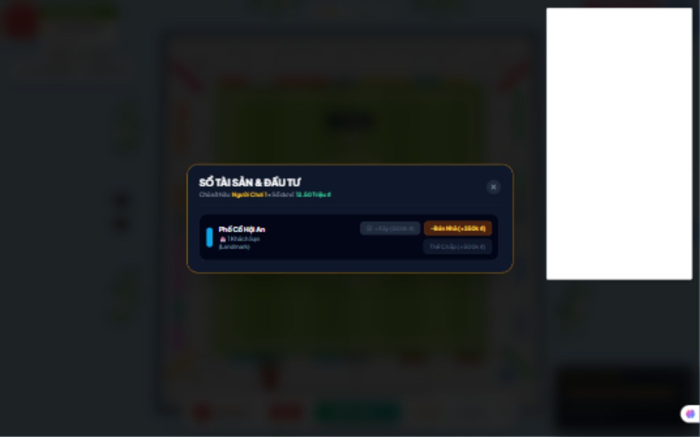
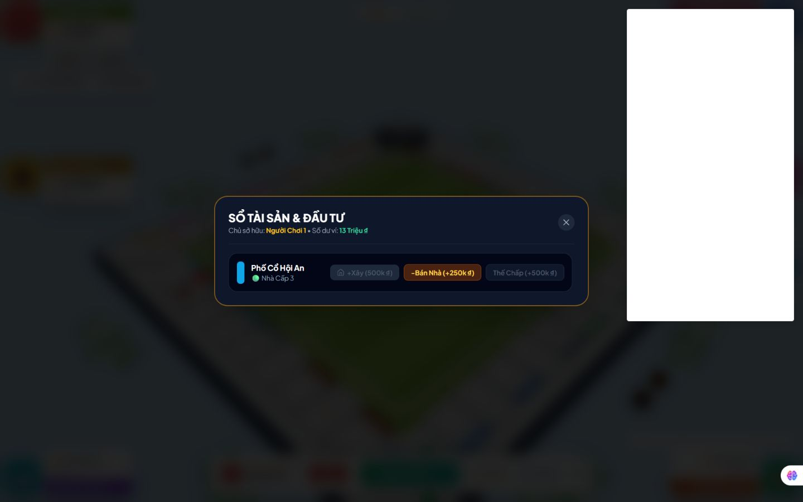
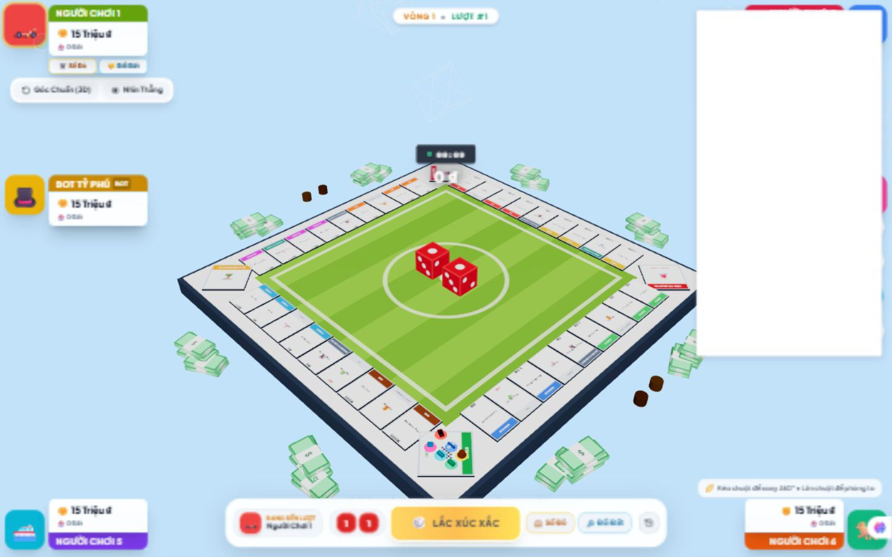

# Review V5 và kết quả khắc phục

Ngày 06/11/2026. Bản được review: commit `81e974a`, so với `8780404`.

## Kết luận trước khi sửa

Bản mới cải thiện rõ: khóa Landmark trong modal mua lần đầu, mặc định chọn cấp thấp, khóa nâng từ xa trong Sổ Đỏ, bỏ bot xây từ xa cuối lượt; Landmark còn 1,25 × 0,85 thay vì rộng hơn ô. Server đã kiểm tra điều kiện thắng bằng engine và lưu pending trade.

Các lỗi dưới đây được phát hiện trước khi sửa. Người dùng đã yêu cầu thực hiện khắc phục; trạng thái cuối cùng nằm ở mục “Kết quả triển khai sau review”.

| Mã | Mức | Lỗi đã xác nhận | Vị trí ở bản review |
| --- | --- | --- | --- |
| V5-01 | P1 | Mua Biệt Thự rồi mở Sổ Đỏ, bấm +Xây lên Landmark ngay cùng lần ghé | gameEngine.js:94; App.jsx:1895 |
| V5-02 | P1 | Handler xác nhận không kiểm tra owner/vị trí, nhận cả tier 2,5; callback quản lý tự ghi state | App.jsx:666–707, 1895–1915 |
| V5-03 | P1 | Server kiểm tra thắng bằng tài sản/danh sách người chơi do chính client gửi; guest tự khai 4 ga hoặc xóa đối thủ vẫn thắng | server/index.js:170–202, 232–245 |
| V5-04 | P1 | Chưa ràng buộc người gửi với lượt chơi; guest sửa được tiền thành 80 triệu và đổi lượt | server/index.js:158–270; App.jsx:393, 1665 |
| V5-05 | P1 | Trade đã lưu ID nhưng vẫn nhận tiền âm; gửi -1 triệu làm bên gửi tăng tiền, bên nhận mất tiền | server/index.js:274–310; App.jsx:1070 |
| V5-06 | P2 | Sáu tâm quân khác nhau nhưng cách nhau 0,22, đế quân đường kính 1,04 → vẫn chồng nhau | Board3D.jsx:593, 1241 |
| V5-07 | P2 | Quân đứng yên không cập nhật slot khi người khác tới/rời ô | Board3D.jsx:1251–1268 |
| V5-08 | P2 | Kết thúc hop xóa animation trước khi snap đích; probe 100 ms/frame còn lệch 0,4 | Board3D.jsx:1020–1022 |
| V5-09 | P2 | Texture ô luôn tạo với false/null, chưa phản ánh owner/thế chấp; giá trên ô vẫn là giá mua | Board3D.jsx:184–199, 861 |
| V5-10 | P2 | Test có tên kiểm tra Landmark lần đầu nhưng chỉ gọi validator nâng nhà; test server chỉ kiểm tra hàm thắng, chưa thử socket thật | test/gameRules.test.js:579–627 |

### Bằng chứng mua nhà trực tiếp

Trên Vercel, Người Chơi 1 đổ 6 + 2 tới Hội An lần đầu. Mua Biệt Thự giá 2 triệu: còn 13 triệu. Mở Sổ Đỏ và bấm +Xây giá 500 nghìn: thành Landmark, còn 12,5 triệu, vẫn lượt #1. Không dùng sửa state trong trình duyệt.

[Snapshot UI](docs/review-v5-2026-11-06/same-visit-ui.txt), [bàn cờ](docs/review-v5-2026-11-06/board-top-view.jpg).

Khung trắng ở phải do môi trường trình duyệt chèn thêm, không tính là lỗi của game. Không suy ra chất lượng GPU/FPS chỉ từ ảnh JPEG.

### Probe code và server

- [Mua nhà và renderer](docs/review-v5-2026-11-06/housing-and-render-result.json): handler thực tế được trích và chạy với setter/ref kiểm soát; xác nhận cả đường bỏ qua validator và lỗi vị trí quân.
- [Socket.IO local](docs/review-v5-2026-11-06/network-probe-result.json): thử trên server riêng cổng 3138, không gửi payload giả mạo tới production.
- [Test/build trước sửa](docs/review-v5-2026-11-06/validation-summary.json): 25/25 test đạt, build thành công; JS 977,27 kB, gzip 264,25 kB. Test đạt chưa chứng minh hết các luồng trên.

## Online và Vercel

Kiểm tra lúc 14:23 giờ Việt Nam: frontend đã là asset `index-CpcGNScD.js`, khớp bản build mới. `/api/health` và `/socket.io/?EIO=4&transport=polling` trả HTML; polling và WebSocket đều kết nối thất bại. Bundle gọi socket cùng origin, chưa có backend URL trong lời gọi đó. [Kết quả kiểm tra](docs/review-v5-2026-11-06/online-check-result.json).

Vì vậy chưa xác nhận được hai người ở hai nơi tham gia cùng phòng trên URL hiện tại. Chưa thử trọn ván qua hai mạng độc lập.

**Cập nhật nhận định hosting:** tài liệu Vercel hiện cho phép WebSocket trên Functions/Fluid Compute. Không tiếp tục dùng khẳng định tuyệt đối “Vercel không hỗ trợ WebSocket”. Repo hiện chỉ build `dist` và rewrite mọi đường dẫn về SPA; điều này không tự triển khai server realtime. [Tài liệu Vercel hiện hành](https://vercel.com/docs/functions/websockets).

Có hai hướng triển khai:

1. Giữ frontend Vercel, chạy Node/Socket.IO ở backend riêng; đặt `VITE_SOCKET_URL` rồi rebuild/redeploy frontend.
2. Triển khai endpoint Function theo hướng dẫn Socket.IO của Vercel, cấu hình đúng path/transport; xử lý reconnect và state dùng chung. [Hướng dẫn Socket.IO của Vercel](https://vercel.com/kb/guide/do-vercel-serverless-functions-support-websocket-connections).

Với hướng Functions, không dựa duy nhất vào `rooms = new Map()` giữa nhiều instance. Cần kho state và cơ chế truyền sự kiện dùng chung; reconnect phải khôi phục đúng người/phòng. Với backend đơn tiến trình, Map phù hợp thử nghiệm nhưng mất dữ liệu khi khởi động lại.

## Cơ chế nhà đề xuất cho dự án

Đây là thiết kế triển khai cho dự án, không phải tuyên bố mọi chi tiết đã khớp Business Tour hiện hành. Mốc moderator về khách sạn cần cấp 3 và ghé lại đã được nêu, kèm giới hạn nguồn lịch sử, trong review V4.

- Mỗi lần đáp ô tạo một quyền mua/nâng có ID và cấp nhà lúc bắt đầu lần đáp.
- Mua mới chỉ mở cấp 1–3 theo ruleset hiện tại; Landmark cần đã có cấp 3 từ trước lần đáp hiện tại.
- Xác nhận hoặc bỏ qua sẽ dùng hết quyền xây của lần đáp đó. Mở lại Sổ Đỏ không tạo quyền mới.
- Người và bot dùng cùng validator, bảng giá và hàm áp dụng hành động.
- Kiểm tra owner, vị trí, phase, tiền, thế chấp, tier nguyên 1–4; không tin giá từ UI.
- Các quyền đặc biệt từ Start/thẻ cần context riêng nếu sau này thêm vào, không suy ra từ việc đang đứng trên đất.

## Kế hoạch hình ảnh

- Giữ công trình hướng vào tâm bàn, quân ở lane ngoài; dùng một hàm layout chung cho cả bốn cạnh.
- Sáu quân phải tính cả footprint, không chỉ tâm khác nhau. Dùng grid nhiều hàng và scale theo mật độ, hoặc cụm đại diện có số lượng.
- Quân đứng yên cần đổi slot khi occupancy thay đổi; quân di chuyển snap chính xác về slot đích khi animation kết thúc.
- Tách lớp thông tin động: owner, thế chấp, cấp, rent hiện tại; giá mua chỉ dùng cho ô chưa có chủ. Dùng panel chi tiết khi chọn ô để đọc tên/tiền rõ.
- Bổ sung preview công trình hợp lệ và hiệu ứng xây ngắn sau khi state được chấp nhận; không cho preview tự ghi ownership.
- Chốt bản rõ và ổn định trước khi thêm nhiều hạt, bloom hoặc motion blur.

## Tiêu chí nghiệm thu

1. Lần ghé đầu mua cấp 3 rồi mở Sổ Đỏ: không lên Landmark được.
2. Ghé lại ở lượt sau, đã có cấp 3, đủ tiền: lên Landmark được đúng một lần.
3. Xây ngoài lượt, ở ô khác, trên đất đối thủ/thế chấp, tier lẻ, xác nhận lặp: không đổi state/tiền.
4. Bot tuân thủ cùng điều kiện; không bị treo khi không có quyền nâng.
5. Guest ngoài lượt không sửa state; payload tự khai ownership/roster không tạo thắng.
6. Trade tiền âm, ID không tồn tại, phản hồi sai người, sửa điều khoản, replay: đều bị chặn.
7. Một tới sáu quân ở ô góc và ô cạnh: không trùng/chồng footprint sau khi ổn định; tới/rời ô cập nhật đủ slot.
8. Animation ở nhiều delta khác nhau kết thúc đúng slot, không lệch X/Z.
9. Đổi owner/thế chấp/cấp làm thông tin bàn cập nhật tương ứng.
10. Frontend public và realtime endpoint được kiểm tra riêng; một người Wi-Fi, một người 4G tạo/vào/chơi cùng phòng trước khi tuyên bố online hoàn tất.

## Kết quả triển khai sau review

**Đã sửa trong workspace, trên nền commit `81e974a`; chưa deploy production.** Các vị trí dòng ở bảng đầu là vị trí trước sửa, không phải số dòng mới.

| Mã | Trạng thái sau sửa |
| --- | --- |
| V5-01, 02 | `createBuildOpportunity`, `validateBuildAction`, `applyBuildAction` là luồng chung. Xác nhận/bỏ qua dùng hết quyền của lần đáp. Owner, vị trí, thế chấp, số nguyên cấp và tiền được kiểm tra lại. Sổ Đỏ gọi cùng handler; người và bot cùng quy tắc. |
| V5-03, 04 | Thêm `server/gameSession.js`: server khởi tạo roster/số dư từ phòng, tự lắc và xử lý mua/nâng, tiền thuê, thẻ, tù, lễ hội, thanh lý và kết thúc lượt. Client chỉ gửi `game_action` có revision. Không nhận `sync_game_state`, kể cả từ host. Client ngoài lượt bị chặn cả UI và server. |
| V5-05 | Server tự cấp ID trade, ràng buộc sender/target, lưu điều khoản, thời hạn 60 giây và revision. Kiểm tra tiền nguyên không âm, số dư, danh sách tài sản/quyền sở hữu tại lúc gửi và lúc nhận. Server áp dụng một lần rồi phát state; client không tự áp dụng lại. |
| V5-06, 07 | `boardLayout.js` bố trí 1–6 quân bằng grid có scale theo footprint. Tính lại slot cho cả quân đứng yên khi occupancy đổi; cập nhật đích cho quân đang đi. |
| V5-08 | `sampleTokenHop` snap chính xác X/Y/Z/scale tại đích, kể cả frame chậm hoặc đổi slot trong lúc đi. |
| V5-09 | Texture đổi theo owner/thế chấp/rent; ô chưa mua hiển thị giá mua. Tên thành phố chuyển về vùng giữa, giá ra mép ngoài; lane quân nhiều hàng tránh vùng giá. Camera mặc định lùi để ô gần không nằm sau dock; theo dõi resize container. |
| V5-10 | Bỏ hai test sao chép logic sanitizer cũ; thêm test gọi engine thật và Socket.IO thật. `npm test` chạy tất cả các suite. |

### Sửa thêm được phát hiện khi mô phỏng ván dài

- Bỏ ràng buộc dỡ nhà/thế chấp theo cả nhóm màu của luật cũ. Mỗi thành phố thanh lý độc lập, nhất quán với xây độc lập; nhà đối thủ không thể khóa việc trả nợ của mình. Đây là quyết định ruleset dự án, không gắn nhãn luật Business Tour đã xác minh.
- Nối lại phiên trong 60 giây bằng token riêng của tab; giữ player ID, số dư, tài sản và revision. Hết thời gian hoặc chủ động rời ván sẽ xử lý bỏ cuộc trên server, tránh kẹt lượt.
- Bổ sung lỗi thao tác có thông báo, timeout gửi hành động và reconnect có backoff.
- Đồng hồ online dựa trên thời điểm server bắt đầu; trận local mới đặt lại đồng hồ/số lượt.
- Cập nhật ref của người đang đến lượt trong render loop; giải phóng texture xúc xắc/model khi thay hoặc unmount, tránh giữ tài nguyên cũ. Không dựng lại toàn bộ nhà chỉ vì số dư người chơi thay đổi.

### Kết quả xác minh

- **54 bài test đạt**: 23 bài hồi quy và 31 bài engine/layout/server; có 8 seed mô phỏng ván 4 người, mỗi seed tối đa 500 hành động.
- Test Socket.IO tạo hai client thật: state giả, roster giả, ngoài lượt, revision cũ, trade âm, sai người nhận, sửa điều khoản và replay đều bị chặn; trade hợp lệ được áp dụng đúng một lần; nối lại giữ player ID; rời ván xác định người thắng đúng.
- Build thành công: asset `index-BarhytB4.js`, 981,78 kB, gzip 266,08 kB. **Vẫn còn cảnh báo chunk lớn**, chưa tách bundle Three.js.
- `git diff --check` không báo lỗi whitespace.
- UI local: lần đầu tới Hội An mua Biệt Thự còn 13 triệu; mở Sổ Đỏ thì **+Xây bị khóa**, không lên Landmark ngay nữa. [Snapshot sau sửa](docs/review-v5-2026-11-06/fixed-same-visit-ui.txt).
- UI hai cửa sổ: chủ phòng lắc 4+6, chuyển lượt; khách lắc 1+2, mua Chợ Lớn cấp 1, còn 14,4 triệu. Cả hai bên hiển thị cùng tiền/tài sản; tải lại khách khôi phục đúng. [Phía host](docs/review-v5-2026-11-06/fixed-online-host-ui.txt), [sau khôi phục](docs/review-v5-2026-11-06/fixed-online-resume-ui.txt).
- Ở viewport 390 × 844, document rộng đúng 390, canvas client 390 × 844; không thấy tràn ngang trong đo DOM. Chưa đo FPS/GPU trên điện thoại thật.
- Lần xem cuối không có console error; còn cảnh báo `THREE.Clock` deprecated, có thể chuyển `THREE.Timer` ở lượt bảo trì thư viện sau.

[Log test/build cuối](docs/review-v5-2026-11-06/implementation-validation.json).

[Góc nhìn từ trên](docs/review-v5-2026-11-06/final-board-top.jpg). Khung trắng do môi trường trình duyệt chèn ngoài game vẫn xuất hiện trong ảnh; không tính là lỗi sản phẩm.

### Phần còn cần làm để đạt mục tiêu hình ảnh và public online

1. **Production:** chưa có backend URL công khai; `vercel whoami` trả lỗi token không hợp lệ. Workspace chưa link project Vercel. Chưa thực hiện deploy và chưa xác nhận chơi Wi-Fi/4G trên URL public. Các bước cụ thể ở [DEPLOY_ONLINE.md](DEPLOY_ONLINE.md).
2. **State bền vững/nhiều instance:** backend mới vẫn lưu phòng trong RAM một tiến trình. Cần lưu state/phiên và pub-sub dùng chung trước khi scale nhiều instance hoặc chuyển sang Vercel Functions; restart hiện làm mất phòng.
3. **Art pass:** model nhân vật/công trình riêng, ghost preview trước khi xác nhận, animation xây theo từng cấp, âm thanh/hiệu ứng theo sự kiện và kiểm tra khả năng đọc tên/giá trên thiết bị thật. Đợt này đã sửa layout và state hiển thị; chưa có bộ asset đạt chất lượng sản phẩm thương mại như Business Tour.
4. **Luật tham chiếu:** các giới hạn cấp thường theo vòng, quyền từ Start/thẻ và nâng sau buyout cần xác minh bằng bản Business Tour hiện hành nếu muốn mô phỏng sát hơn. Không tuyên bố giống 100%.

Các JSON/ảnh và script probe trước sửa ở đầu tài liệu là bằng chứng của commit review. Chúng không phải bộ test hồi quy của code mới; kiểm tra bản hiện tại bằng `npm test` và các file trong `test/`.
